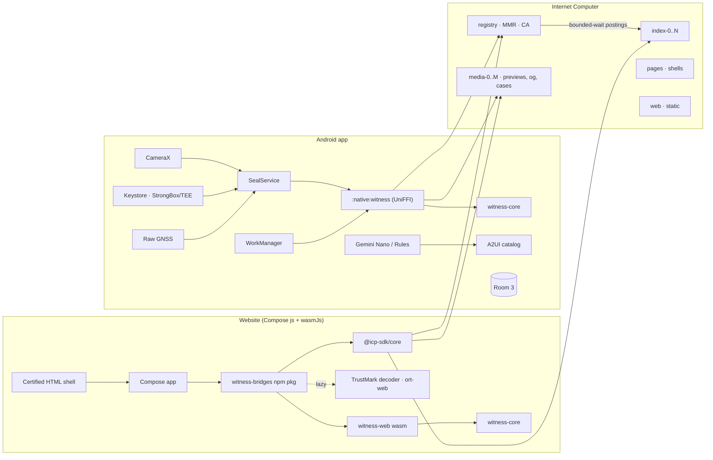
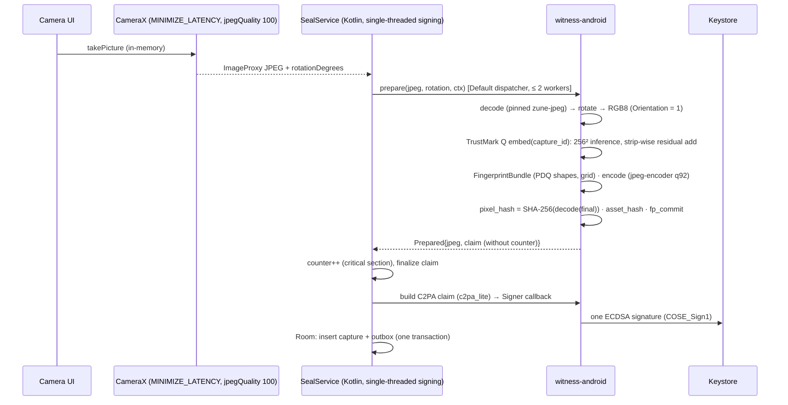

# Witness — Technical Design

Companion to [SPEC.md](SPEC.md). The spec says *what* and *why*; this says *how*, precisely enough to build from. When they disagree, fix one of them in the same change.

**Status:** revision 4, built and running on a local replica. Revision 4 brings the document in line with what was actually built (the build decisions in `BUILD.md` and the deviations the build reports recorded). Revision 3 added the architecture critique's findings, and revision 2 incorporated a four-lens adversarial review (security, ICP, algorithms, client). §16 records what changed and why; `docs/dev/STATUS.md` tracks what works today.
**Targets:** Android app + website (Compose Multiplatform), Rust core, ICP canisters.

---

## 0. Decisions at a glance

| # | Decision | Why |
|---|---|---|
| D1 | **One Rust "truth" crate** (`witness-core`) owns decoding, resampling, fingerprints, the region grid, alignment and the verdict, and is bit-identical on arm64 and wasm32. | Verdicts must never differ by platform. That only holds if the *pixels* entering the shared code are identical too. |
| D2 | **ORIGINAL is cryptographic only.** It comes from a C2PA manifest whose signer resolves to an enrolled, non-revoked registry key, or from an exact asset/pixel hash hit. Perceptual evidence tops out at *Matches an original, with changes*. | Matches spec §13, which treats integrity as absolute. A chain to a Google root on its own proves nothing about Witness. |
| D3 | **Key Attestation is the device proof; Play Integrity isn't used.** Keys are generated after an online challenge ("fresh"); offline keys are allowed with a bound ("late"). | Works offline, can be verified on-chain, and needs no secrets in a canister. |
| D4 | **Witness issues the C2PA signing certificate.** At enrollment, a canister-held Ed25519 CA (threshold Schnorr) certifies the device's hardware key with a C2PA-valid profile. | Key Attestation leaf certificates have no EKU, and c2pa-rs refuses to sign with them. |
| D5 | **One hardware signature per capture:** the C2PA COSE_Sign1 *is* the seal, and the registry verifies it. | Halves signing latency (StrongBox ≈ 90 ms per operation). |
| D6 | **Lookup has three layers:** exact hash, then watermark (root capture ID), then multi-shape PDQ. **Confirmation is geometric alignment, not lookup distance.** | No single mechanism survives crops, screenshots and recompression, and PDQ hits on their own are forgeable. |
| D7 | **Permanent versus erasable data.** The `registry` keeps minimal records plus commitments; fingerprints, grids, previews and pages are erasable. | PDQ hashes and grids are potentially reconstructive personal data. |
| D8 | **Records are keyed by `record_id`** (a hash of the claim). `capture_id` is only a watermark lookup hint. | A 56-bit random ID collides at scale. |
| D9 | **Certification lives in stable memory** (a Merkle Mountain Range), roots are published externally, and policy is compiled into the wasm. | Upgrades cost O(1), and history rewrites become publicly detectable. |
| D10 | **Clients fan out to index shards with ordinary queries;** there are no composite queries. | Composite calls share one 5B-instruction budget, are same-subnet only, and can't be replicated. |
| D11 | **Case links are E2EE** (AES-256-GCM, key in the `#fragment`) and served from their own origin with a strict CSP. | Zero server knowledge; the remaining trust is web-code delivery, stated openly. |
| D12 | **Web pages are certified HTML shells; the Compose app loads on top.** Every web-reachable module targets **js + wasmJs**. | Link previews, accessibility and first paint need HTML, and CMP compatibility mode needs a full JS build. |
| D13 | **A2UI templates are data** (recorded A2UI 0.9.1 message lists plus a slot schema); the model fills one generic `@Generable` slot list, validated at runtime and mapped into `updateDataModel`. | New situations ship without an app update, and a bad answer can't produce a broken screen. |
| D15′ | **One C2PA implementation:** `witness-core::c2pa_lite` (crate `witness-c2pa`) both *writes* and *verifies* a minimal C2PA 2.x profile on every platform and in canisters: claim v2, assertions `c2pa.actions.v2`, `c2pa.hash.data` and `app.witness.claim`, COSE_Sign1 ES256 with `x5chain`, JUMBF in JPEG APP11. The `c2pa` crate is a **host-only dev-dependency** used to validate our manifests with c2pa-rs `Reader`; it is never linked into Android or canisters. | Keeps verdicts deterministic, drops a pre-1.0 JS dependency, and keeps a large native dependency out of the APK. Supersedes D15 (rev 4). |
| D16 | **Owners can delete their own erasable data** with a device-key signature or a linked Internet Identity. Plus entitlements come from signed grants. | Matches the spec's deletion promise without making accounts mandatory. |
| D14 | **Highly modular Gradle build:** `core/*`, `feature/*` and one native bridge module. | Clear boundaries, and web code can't reach Android APIs. |
| D17 | **TrustMark is split:** the BCH_5 codec, 256×256 preprocessing and residual upsample-and-add are pure code in `witness-core::watermark`; the ONNX session lives in `witness-android` behind the cargo feature `trustmark` (off by default). Models come only from `scripts/fetch-models.sh` with pinned SHA-256 values. | Without models the app and site report "watermark unavailable" and fall back to exact-hash and PDQ lookup, so nothing depends on a 64 MB download. |
| D18 | **Dev attestation for local builds only:** the `registry` feature `dev-attestation` also accepts the Android emulator's attestation roots and unverified boot. Such keys get `provisioning = Dev`, and every proof from them carries a **DEV** badge. | The whole flow runs on an emulator without weakening production policy. |
| D19 | **Telemetry is a port, off until opt-in.** `Telemetry` (events, breadcrumbs, non-fatals) with a no-op default; the Android actual is Firebase Analytics + Crashlytics, and its Gradle plugins apply only when `client/androidApp/google-services.json` exists. The web has no telemetry. | Builds and runs without any Firebase project or secret; nothing is collected unless the user asks. |
| D20 | **Local deployment with the `icp` CLI** (`icp.yaml`, gateway on `127.0.0.1:8090`), scripted by `scripts/deploy-local.sh` and checked by `scripts/smoke-local.sh`. Nothing is deployed beyond a local replica. | One reproducible command brings up all five canisters with matching init args. |

---

## 1. System overview



| Holder | Data | Lifetime |
|---|---|---|
| Phone | Originals, unredacted images, precise location and its opening, private keys (non-exportable), retired keys | User-controlled |
| `registry` | `SignedClaim` (minimal claim), `KeyInfo`, MMR, Witness CA, revocations, shard map | **Permanent** (append-only) |
| `index-*` | Full PDQ hashes, grids, MIH postings, watermark, exact-hash and derivative tables | Erasable (takedown/GDPR) |
| `pages` | Certified HTML shells, `/.well-known`, tombstones | Erasable |
| `media-*` | Previews, link-preview images, encrypted case chunks | Erasable, expiring |
| `web` | Compose bundles (wasm + JS), fonts, models | Static |

---

## 2. Repository and module layout

```
witness/
  client/                                Gradle root · Kotlin 2.4.21 · CMP 1.12.2 · AGP 9
    build-logic/convention/              witness.kmp.library (android + js + wasmJs, webMain shared)
                                         witness.kmp.android · witness.cmp · witness.android.app · witness.web.app · witness.metro
    native/witness/        [android lib] cargo-ndk jniLibs + the single UniFFI Kotlin file + JNA + Kotlin adapters (app.witness.nativelib)
    core/
      model/          [android, web]     Pure Kotlin view types: Verdict, ProofView, Region, CaseSummary …
      designsystem/   [android, web]     Tokens, type (Inter + JetBrains Mono), base components
      ui/             [android, web]     VerdictCard, ProofFacts, ChainOfCustody, ProvesCard, ReferenceCompare, GeneratedSurface
      domain/         [android, web]     Ports + use cases, no platform code
      verify/         [android, web]     VerifyEngine port: actual = :native:witness (android) / witness-bridges (webMain)
      icp/            [android, web]     Registry/Index/Media gateways: actual = ic-agent via :native:witness / @icp-sdk/core
      data/           [android]          Room 3, DataStore, outbox, WorkManager anchoring
      platform/       [android]          CameraX, Keystore, GNSS, ML Kit (face, text, GenAI), share intents
      a2ui/           [android]          Witness A2UI catalog v1 + template store + event sink
      telemetry/      [android, web]     Telemetry actuals: no-op (common), Firebase Analytics + Crashlytics (android)
    feature/
      home/ capture/ post/ case/ share/ settings/   [android]
      check/  [android, web]             Check tab, /check
      proof/  [android, web]             Item proof (app), /p/{record_id}, /v/{case_id}
    androidApp/                          Application, Metro graph, Navigation 3 host
    androidBenchmark/                    Macrobenchmark + Baseline/Startup profiles
    webApp/                              Web entry (js + wasmJs), index.html, bridges/ (npm package "witness-bridges")
  crates/
    witness-core/                        Facade + seal() pipeline; re-exports the pure crates below
    witness-format/                      Canonical CBOR, ids, claim, edits, keys, crypto domains (no_std)
    witness-image/                       Pinned decoders, orientation, fixed-point resampling, pixel_hash
    witness-fingerprint/                 Integer PDQ, PDQ shapes, region grid, MIH keys
    witness-match/                       Extraction, alignment, photometric fit, change map
    witness-c2pa/                        c2pa_lite: C2PA writer + verifier (D15′)
    witness-merkle/                      MMR + sparse Merkle tree
    witness-attest/                      Key Attestation policy (§4.2), challenges, dev roots behind `dev-attestation`
    witness-watermark/                   TrustMark BCH_5 payload, preprocessing, residual (no ONNX)
    witness-verdict/                     judge(), Oracle, verdict rules
    witness-android/                     cdylib: UniFFI 0.32.2 · witness-core · ic-agent 0.45 (tokio, ring) · ort rc.15 behind `trustmark`
    witness-web/                         cdylib: wasm-bindgen exports, plan/judge loop, certificate + proof checks
  canisters/  common/  registry/  index/  pages/  media/  web/
  tools/witness-smoke/                   End-to-end smoke test against the local replica
  scripts/                               deploy-local, smoke-local, build-canister, build-android-native, stage-web, fetch-models, check-*-deps
  design/  docs/
```

**Crate split (rev 4).** `witness-core` is a thin facade: the logic lives in ten small `no_std`-friendly crates with one job each, and `witness-core` re-exports them (`witness_core::{format, image, fingerprint, matching, c2pa, merkle, attest, watermark, verdict}`) plus the `seal()` pipeline. The determinism rules of D1 apply to all of them, and `scripts/check-core-deps.sh` checks the wasm32 tree of `witness-core`.

**Module rules** (enforced by convention plugins plus a Gradle check task):
- `feature/*` → `core/{model,designsystem,ui,domain}` only. A feature never depends on another feature.
- `core/domain` has no platform code. Every IO edge is a port with `androidMain`/`webMain` actuals.
- Web-target modules declare **`js(IR){browser()}` and `wasmJs{browser()}`**, sharing `webMain`, so `composeCompatibilityBrowserDistribution` can build the JS fallback.
- **`:native:witness` is the only module that carries the cdylib and its generated bindings.** It also holds the Kotlin adapters that implement the domain ports over UniFFI (`NativeSealEngine`, `NativeVerifyEngine`, `NativeRegistry`, `NativeIndex`, `NativeMedia`). `core/verify`, `core/icp` and `core/platform` do not depend on it (the build-logic module rules enforce this); only `androidApp` wires it in, through `NativeAvailability`.
- **Rust:** `canisters/*` depend on the pure core crates and `canisters/common` only. `scripts/check-canister-deps.sh` fails if `wasm-bindgen`, `c2pa`, `ort`, `getrandom/js`, `tokio` or `reqwest` appear in their `wasm32-unknown-unknown` tree.

**Dependency injection:** Metro, one graph per shell.
**Navigation:**
- **Android:** Navigation 3 with `@Serializable` keys.
- **Web:** a tiny `WebRouter` reads `location.pathname` at boot and uses `history.pushState`. Three routes: `/p/{record_id}`, `/v/{case_id}`, `/check`.

---

## 3. Formats (`witness-core::format`)

Every signed or hashed structure is **canonical CBOR**: RFC 8949 §4.2.1 core deterministic encoding, with integer keys and key `0` = version.
- **Decoders reject:** non-round-tripping input, indefinite lengths, floats, tags, duplicate or unknown keys.
- **The registry re-encodes** each claim and rejects it if the bytes differ.
- **ECDSA** signatures are normalized to low-S.

### 3.1 Identifiers
| ID | Definition | Use |
|---|---|---|
| `capture_id` | 56 CSPRNG bits + 5-bit schema = 61 bits (TrustMark BCH_5 payload). **Layout:** schema in bits 56–60, random in bits 0–55; serialized most significant bit first | **Watermark hint only**; collisions are expected at scale |
| `record_id` | `SHA-256(claim_cbor)[..10]`, Crockford base32 (16 chars, upper case) | Public ID: URLs `/p/{record_id}`, certification, takedown |
| `case_id` | `shard u8 ‖ 15 random bytes`, Crockford base32 (26 chars) | Case links; the first byte routes to the media shard |
| `record_ix` | Dense `u64` assigned by `registry` | MMR leaf index, shard routing |
| `key_id` | `SHA-256(SPKI)[..16]` | Key reference |
| `local_ix` | `u32`, assigned by the index shard in `put` order (no `shard_base`) | Index postings |

**Display IDs** use the canonical Crockford alphabet (`0-9 A-Z` minus `I L O U`), so an example like `H4IL-…` can't occur. Decoders accept lower case and read `I`/`L` as `1` and `O` as `0`, but **only the canonical upper-case path is certified** on `pages`, so shareable links always carry the canonical form. `grouped()` renders `XXXX-XXXX-XXXX-XXXX` for people.

**Versioned structs.** Only top-level hashed or exported structs carry key `0` = version: `WitnessClaim` (2), `FingerprintBundle`, `KeyInfo`, `Submission`, `LocationOpening` (1). Nested maps (`Kind`, `Edit`, `Time`, `Loc`) start their fields at key `0`. `Kind` is `{0: tag, 1: parent, 2: root, 3: edits}`; `dims`, `key`/`counter` and status changes are 2-element arrays; `Checks` is one packed uint.

### 3.2 `WitnessClaim` (assertion `app.witness.claim`, permanent)
| Key | Field | Notes |
|---|---|---|
| 0 | `v` = 2 | |
| 1 | `capture_id` | |
| 2 | `kind` | `Original` or `Derivative{ parent: record_id, root: capture_id, edits: [Edit] }` |
| 3 | `asset_hash` | Data hash of the sealed JPEG with C2PA segments excluded (equals the C2PA hard binding) |
| 4 | `pixel_hash` | `SHA-256(u32be(w) ‖ u32be(h) ‖ decode_rgb8(final_jpeg))`, **computed after encoding** with the pinned decoder, before EXIF orientation. The dimensions are included so a 2×3 and a 3×2 image with the same bytes never collide |
| 5 | `fp_commit` | `SHA-256(canonical CBOR of the FingerprintBundle)` (§3.3) |
| 6 | `dims` | Post-orientation width and height |
| 7 | `time` | `{wall_ms, gnss_ms?, elapsed_ns, boot_count}` |
| 8 | `loc` | `{commit?: [u8;32], confidence, reasons}` (no coarse cell on originals) |
| 9 | `checks` | Key provenance, boot state, GNSS checks, mock flag, recapture score |
| 10 | `key_id`, `counter` | The counter is assigned inside the signing critical section |
| 11 | `cert_serial` | Serial of the Witness C2PA cert used |
| 12 | `coarse?` | Geohash-5, **only on published derivatives** |

The format crate enforces: `coarse` only on derivatives, a derivative's `loc.commit` is `None`, non-zero dims, ≤ 64 edits, and `cert_serial` 1–20 unsigned bytes with no leading zero.

The **seal** is the C2PA manifest's COSE_Sign1. The claim's assertion is hash-bound in the C2PA claim, so one signature covers the claim, the asset binding and the C2PA metadata. `registry.submit` receives `{claim_cbor, c2pa_claim_cbor, cose_sign1, fingerprints?}` and verifies all three with `witness-core::c2pa_lite`, a minimal parser for COSE_Sign1 and the claim's assertion-hash list. The c2pa crate stays out of canisters. The optional `fingerprints` field carries the FingerprintBundle CBOR so the registry can check `fp_commit` and forward it to `index` (rev 4).

### 3.3 `FingerprintBundle` (erasable, stored in `index`)
- `pdq: [(shape_tag u8, [u8;32])]`: about 15–19 shapes (§5.1), plus PDQ `quality`.
- `grid: [u16; 192]`: 16×12 (landscape) or 12×16 (portrait), 8 sign bits + 8 stability bits per cell (§5.2) = 384 B.

### 3.4 Location commitment
- `commit = SHA-256("witness/loc/v1" ‖ salt256 ‖ i32be(lat_e7) ‖ i32be(lon_e7) ‖ u32be(acc_cm))`.
- The **salt and opening never go into any C2PA assertion by default.** They stay in the app DB and in an explicit, user-created "Prove location" export.
- Derivatives carry `coarse` or nothing.

---

### 3.5 `Edit` schema (derivatives)
`Edit` is a canonical CBOR map `{0: kind, 1: params}`. Each kind has a class, which decides how it affects the verdict.

| Kind | Params | Class |
|---|---|---|
| `resize` | `{w, h, filter}` | presentation |
| `recompress` | `{format, quality}` | presentation |
| `orient` | `{0..7}` | presentation |
| `crop` | `{x, y, w, h}` in parent pixels | global |
| `rotate` | `{deg_e2}` (≤ ±10°, straighten) | global |
| `tone` | `{exposure_e2, contrast_e2, saturation_e2}` | global |
| `filter` | `{id, strength_e2}` from a fixed bundled list | global |
| `blur` | `{rect, class: face/plate/house_no/other, sigma}` | local, declared |

- **Presentation-only derivatives** verify as `ORIGINAL`.
- **Global and declared-local edits** give `MATCHES_WITH_CHANGES`, with the edits listed.
- **A declared blur explains a region only if the copy's pixels inside the rect are actually blurred:** high-frequency energy below a threshold relative to the parent's grid. Otherwise the region counts as an undeclared change, so a "blur" rectangle can't hide an edit.

## 4. Keys, enrollment, C2PA identity

### 4.1 Key lifecycle
1. **Online:** `challenge()` returns a stateless `issued_ns ‖ HMAC(secret, issued_ns)`, and the hardware key is generated with that as its attestation challenge. Result: `freshness = Fresh`.
2. **Offline at first launch or rotation:** the challenge is `SHA-256("witness-offline" ‖ install_nonce ‖ wall_ms)`. At enrollment the registry accepts it if the attested `CREATION_DATETIME` (or the leaf `notBefore`) is ≤ 7 days old. Result: `freshness = Late`. Captures before enrollment are **claim-sealed**, and their C2PA manifest is built after enrollment, before the file can be shared.
3. **Algorithm and storage:** P-256 ECDSA, preferring StrongBox and falling back to TEE when StrongBox P90 is above 120 ms per signature (measured in M0). The security level is recorded in `checks`.
4. **Rotation:** clients rotate keys after 30 days when online.
   - **Server-enforced window:** the registry accepts originals only while `wall_ms ≤ enrolled + 60 days` (§7.2).
   - Retired keys stay in Keystore and keep signing **derivatives of their own captures** forever.
   - If a parent key is lost (reinstall), the derivative is accepted only with the parent's sealed `asset_hash` as a C2PA ingredient, and is shown as weaker.
5. **Principals:** each key enrolls and submits with a fresh anonymous ICP principal, so nothing links keys on-chain.

### 4.2 Enrollment verification (`registry.enroll`, compiled-in policy)
1. **Chain:** pinned root **SPKIs**: the single RSA-4096 key behind all `f92009e853b6b045` root certificates, and the P-384 "Key Attestation CA1" key (2025-07-17 → 2035-07-15).
   - Verify every signature, `basicConstraints` and `pathLen`.
   - Enforce validity on every certificate. The only exception is the **intermediates and root** of the legacy RSA factory hierarchy, which Google says to trust regardless of validity. **Leaf validity is always enforced,** including `notBefore`, which the Late-key rule uses when `CREATION_DATETIME` is absent.
2. **Extension placement:** use the first KeyDescription (OID `1.3.6.1.4.1.11129.2.1.17`) **closest to the root**, after any provisioning-info certificate (`…2.1.30`). Reject chains with a second occurrence above it.
3. **Hardware-enforced requirements:**
   - `attestationSecurityLevel`, `keyMintSecurityLevel` ∈ {TEE, StrongBox}
   - `RootOfTrust`: `verifiedBootState=Verified`, `deviceLocked=true`
   - `origin=GENERATED`, `purpose ⊇ SIGN`, `algorithm=EC`, `ecCurve=P_256`, `osPatchLevel ≥ MIN_PATCH`
4. **App identity:** the leaf SPKI must match `key_id`. `attestationApplicationId` (software-enforced, so it's a weaker signal) must carry package `app.witness`, version ≥ `MIN_VERSION`, and the release signing digest.
5. **Challenge:** a Fresh challenge must have a valid HMAC and be ≤ 1 h old; a Late challenge follows the rule in §4.1.
6. **Revocation:** every chain serial, normalized as an unsigned big integer in lowercase hex with no leading zeros, must be absent from the revocation map.
7. **Provisioning:** `RKP` if the provisioning-info extension is present or the chain ends at the P-384 root; otherwise `FACTORY`, which is shown as the weaker "legacy device check".
8. **Quotas, keyed by the certificate *immediately above the leaf*:**
   - Under RKP, that's the device's own attestation-key certificate, which is per device and rotates every few weeks. Google's shared RKP intermediates sit above it and are never used as a quota key.
   - Under FACTORY, it's the batch certificate.
   - **Limits:** ≤ 5 keys per 30 days per device certificate, which allows for reinstalls and TEE+StrongBox. Factory batches get progressive backoff with an alarm, never a hard global block, so one leaked keybox can't lock out every legacy phone.
   - The exact chain shapes are checked against real Pixel and Samsung chains in M0.
   - Reservations are written before any `await` (§7.2).
9. **Stored and returned:**
   - Store only the derived `KeyInfo` (§7.2: status *history*, `active_until`, `chain_serials`). The chain itself is never stored or served, which avoids linkability.
   - **Issue a C2PA certificate** (§4.3) and return it.

**Dev attestation (`dev-attestation`, local builds only; D18).** The feature lives in `witness-attest` and is turned on through the `registry` feature of the same name; `icp.yaml` builds the local registry with it and production builds never do.
- **Extra Dev roots:** the AOSP software attestation roots (EC and RSA) and the API 36 emulator's RKP test root "Droid Unregistered Device CA" (SPKI SHA-256 `ff7a4c04…a1a14e20`).
- **Relaxed rules on a Dev root only:** unverified boot is accepted, and the provisioning-info extension that the emulator's test root itself carries is ignored by the placement rule (rule 2). Google-rooted chains stay strict.
- **App identity:** the signing digest accepted for Dev keys is `WITNESS_DEBUG_DIGEST`, which `scripts/build-canister.sh` reads from `~/.android/debug.keystore`; the release digest comes from `WITNESS_RELEASE_DIGEST` and is a placeholder until a release key exists.
- **Quotas:** every emulator shares one intermediate, so Dev (and FACTORY) chains get progressive backoff instead of the hard 5-per-30-days cap, which stays for RKP.
- **Result:** `provisioning = Dev`. Every surface that shows a proof from such a key (app, `/p` shell, case page, check result) shows a **DEV** badge and "development device" wording, never "genuine phone"; dev shells are `noindex`.

### 4.3 Witness C2PA identity
- **CA:** `registry` holds a threshold Schnorr **Ed25519** key (`sign_with_schnorr`, key name from `WITNESS_SCHNORR_KEY`, `dfx_test_key` locally) as the Witness CA. Its root certificate is pinned in the apps and the website.
  - **Local replica:** the root is generated at runtime, so the registry also exposes a `ca_root` query and returns `ca_cert` from `enroll`. Android caches it on disk after the first fetch. The website accepts the uncertified `ca_root` answer **only when `config.local` is set**; a production build must pin `config.anchor` or `/check` fails closed. **Anchor pinning (rev 4 closeout):** `deploy-local.sh` writes `ca_root` (hex DER) into `.icp-local/ids.json`; `stage-web.sh` puts it in `witness-config` as `anchor` and refuses a non-local staging without `WITNESS_CA_ROOT` and `WITNESS_REGISTRY_ID`; Android reads it into BuildConfig `WITNESS_CA_ROOT` (local from `ids.json`, otherwise `-Pwitness.caRoot`) and passes it as `WitnessConfig.caRoot`. Three modes: **pinned**; **dev** (local only, `ca_root` queried, `devAnchor`/`dev_anchor` set, DEV shown); **missing** (production without an anchor: Content Credentials are judged against `UNPINNED_ANCHOR_DER`, a self-signed CA whose private key was never kept, so a Witness manifest reads `unverified` and the check continues on the hash/PDQ path; Android reports `credentials_judged = false` and production refuses to start the native client).
- **Per-key leaf certificate:**
  - X.509 v3 for the device P-256 key
  - `keyUsage=digitalSignature` (critical)
  - `EKU=id-kp-documentSigning` (1.3.6.1.5.5.7.3.36), with `c2pa-kp-claimSigning` added if Witness joins the C2PA trust list
  - AKI, SKI, `cA=false`
  - `notAfter` = 10 years, because revocation is tracked in the registry, not by expiry; offline captures can't get a timestamp-authority stamp
- **Signer:** `Signer.cert_chain()` returns `[leaf, witness_root]`. Kotlin (`VaultSigner`) returns the raw Keystore DER signature and Rust converts it to 64-byte low-S `r‖s`.
- **M0 gate (passed, D15′):** `c2pa_lite` writes the manifest; c2pa-rs `Reader` (host dev-dependency) reads it with no failure codes and reports the chain **Trusted** when the Witness root is its anchor.

### 4.4 Revocation sync
**Status (rev 4): not built.** Enrollment checks against an empty revocation list and there is no outcall yet; `witness-attest` already parses the status list. The design below stands.

- A timer (registered by `start_timers()` in both `init` and `post_upgrade`) fetches `https://android.googleapis.com/attestation/status` daily.
- **Outcall:** `max_response_bytes = 1_000_000` with v2 pricing. The transform function parses the JSON and emits a canonical, sorted `serial → {REVOKED|SUSPENDED, reason}` list. Measured 2026-11-19: 182 KB, 1,789 entries.
- **Failure:** retries at 1 h, then 4 h. `revocations_as_of` is exposed, and the flag `revocation_stale` is raised after more than 7 days. Only `force_sync` is callable, and only by controllers.
- **Keys:** a hit marks the key `Revoked`/`Suspended` with `status_since`. Submits from it are rejected. Records anchored earlier show `key_revoked_after_anchor`.

---

## 5. Capture and seal (Android)



- **SealService** is narrow: no reflection or dynamic code loading. It's the only code path that touches the signing key.
- **As built (rev 4):**
  - The encoder is the pure-Rust `jpeg-encoder` (pinned, SIMD off) inside `witness-image`, not turbojpeg; the manifest is written by `c2pa_lite` (D15′).
  - `NativeSealEngine` runs native `prepare` **inside** `seal()`, where the key id, cert serial and counter are known, because `CaptureMeta` needs them. The domain `PreparedCapture.draft` therefore carries placeholder hashes; the real claim comes back in `SealedCapture.claim`.
  - Sealing needs an enrolled key (the claim carries the cert serial), so captures cannot be claim-sealed before enrollment yet; the seal fails with `not_enrolled`. The reseal-after-enrollment path of §4.1 is open.
  - The sealed JPEG and the claim CBOR are stored content-addressed in app-private `captures/<record_id>.jpg`.
  - Derivatives (posts) are rendered from the root original by `BitmapEditRenderer`: Crop, Resize and Blur are applied to pixels (blur is a three-pass box blur approximating the declared Gaussian σ); Rotate, Tone, Filter and Orient are declared but not yet rendered. A derivative claim never carries the parent's location commitment.
- **Budgets:**

  | Measure | P50 | P90 |
  |---|---|---|
  | Image available → sealed | ≤ 0.7 s | ≤ 1.0 s |
  | Shutter → sealed | ≤ 1.2 s | — |

  The signature budget is ≤ 120 ms. All of these are measured in M0 with Macrobenchmark on a Pixel 8 and one mid-range phone.
- **Resolution and memory:**
  - CameraX `ResolutionSelector` caps capture at **12 MP (4032×3024)**, so 50 MP sensors bin down.
  - Ultra HDR gain maps and maker notes are stripped before encoding.
  - Pooled RGB8 buffers (36 MB each), at most 2 workers, and the residual is added in row strips. There's never a full-frame f32 buffer.
- **TrustMark (D17):** the trustmark crate isn't used (its `ort` is pinned too old). Its pure logic (BCH_5 payload, 256² preprocessing reproducing Pillow's bilinear exactly, residual) lives in `witness-core::watermark` and matches Adobe's reference packets bit for bit. The ONNX session is in `witness-android` behind the `trustmark` feature, on `ort 2.0.0-rc.15` with `load-dynamic` (the app must then ship `libonnxruntime.so`), CPU EP and 2–4 intra-op threads. Separate sessions load from memory: the encoder for sealing and the decoder for checking. **Without models**, sealing skips the watermark and checks report "watermark unavailable", falling back to exact-hash and PDQ.
- **Watermarks are embedded once, on originals.** Derivatives never re-embed, so they carry the root `capture_id`.
- **GNSS:** a 10 s ring buffer of `GnssMeasurementsEvent`, checked for C/N0 spread, AGC jumps, pseudorange residuals, clock-drift continuity and `isMock`. Results:
  - *High*: raw checks pass
  - *Medium*: fused fix only, e.g. indoors
  - *Low*: inconsistent
- **Network consistency (on-device only):** the cell network's country code (MCC) must match the GNSS fix's country, and Wi-Fi or cell presence is recorded as a weak signal. Witness never queries a network-location service (Android's network provider sends scans to Google), so there are no BSSID or cell-ID lookups.
- **Recapture score:** a moiré FFT peak plus depth flatness where a depth sensor exists. It only adds warnings.

### 5.1 Model delivery
| Model | Size | Delivery | Used by |
|---|---|---|---|
| `encoder_Q.onnx` | 17.3 MB | Install-time Play AI pack (read via AssetManager → `commit_from_memory`) | Seal |
| `decoder_Q.onnx` | 47.4 MB | Fast-follow AI pack | Check. Until it arrives, Check runs exact + PDQ only and says so. |
| int8 decoder (to evaluate) | ≤ 12 MB | Replaces both of the decoder's deliveries if quality holds | Check, web |

Non-Play builds download from `web` and verify a pinned SHA-256. The APK budget is ≤ 40 MB excluding packs.

**Fetching (rev 4):** models are never committed and never downloaded by a build. `scripts/fetch-models.sh --download` fetches `encoder_Q.onnx` and `decoder_Q.onnx` into `models/` (git-ignored) and verifies `WITNESS_ENCODER_Q_SHA256` / `WITNESS_DECODER_Q_SHA256`; it refuses to run until both digests are pinned, which hasn't happened yet.

---

## 6. Matching (`witness-core`)

**Determinism rules** (D1):
- All decoding (zune-jpeg, zune-png, image-webp) and resampling happen in `witness-core`:
  - integer or fixed-point Jarosz/box filters
  - a fixed EXIF-orientation policy
  - no color management
- DCT cosine tables are compile-time constants. Only `+ − × / sqrt` are used, reductions run in a fixed order, and ties break by index.
- **Other formats:** HEIC/AVIF are decoded by the platform (Android `ImageDecoder`, browser `createImageBitmap`). That input is outside the determinism guarantee. It can never reach *Original* through a pixel hash, perceptual results carry a "decoded by the system" caveat, and the golden test covers JPEG, PNG and WebP only.
- **Floating point:** rustc never contracts `a*b+c` into a fused multiply-add unless `mul_add` is called explicitly, so arm64 and wasm32 round identically. `witness-core` doesn't use `mul_add`, and the golden test enforces it.
- **CI golden test:** 200 inputs run through `judge()` on `aarch64-linux-android` (emulator) and `wasm32` (node) must produce **bit-identical outputs**.

### 6.1 PDQ shapes
| Side | Hashes |
|---|---|
| **Stored** (per capture) | Aspects {full, 1:1, 4:5, 3:4, 9:16, 16:9, 1.91:1} × offsets {start, center, end} on the free axis where they differ by > 5% of the frame, giving ≈ 15–19 hashes. Quality ≤ 49 hashes aren't indexed. |
| **Query** (≤ 16 per probe) | For each extracted rectangle (≤ 3): the base hash, ±4% inset/outset, and the horizontal mirror, which comes free from PDQ's dihedral support |

PDQ is only for near-whole-frame copies. Arbitrary crops rely on the watermark, plus alignment for confirmation.

**As built:** PDQ is integer-only (BT.601 luma rounded to u8, witness-image's Q8 Jarosz filter, an i32 DCT table scaled by 2¹⁶), so it is bit-identical on every target and within a few bits of Meta's float reference. Shapes are hashed on a 512 px working image, inset/outset is ±4% of each dimension (2% per side), and the stored set skips an aspect equal to the frame. `FingerprintBundle` holds one quality value, so the index exposes `quality` and `portrait` per capture.

### 6.2 Region grid
- Computed on an aspect-preserving downsample (256 px long edge) as a 16×12 or 12×16 grid.
- **Per cell:** 8 sign bits of low-frequency DCT coefficients against the cell median, plus 8 *stability* bits, set where |coefficient − median| > κσ.
- **Comparison:** stable bits only, normalized by the number of stable bits. Cells with fewer than 4 stable bits are uncomparable and lower `compared_fraction`, rather than producing false changes.
- **Stated detection floor:** the grid detects edits of about half a cell or more with substantial content change. **Digit- or text-level edits need the pixel path** (§6.4).
- **As built:** the 8 bits come from the 3×3 low-frequency DCT minus DC; a bit is stable when |d| > ¼·mean|d| and at least 1 luma level. Comparison uses the **union** of both grids' stable bits, so texture pasted into a flat area is caught. Alignment accepts at τ = 0.75 agreement, a 0.10 margin over a geometrically distinct runner-up, and ≥ 48 compared cells.
- **Coverage (rev 4):** on the grid path, `compared` = compared cells ÷ cells that *could* be compared (textured in the reference, or compared anyway), capped at 1. A full-frame copy scores 1.0; textured cells outside a crop still count against it. (Measuring compared ÷ all cells counted flat sky as "not covered" and sent about half of plain recompresses to "couldn't compare".)
- **Small-image change floor (rev 4):** a changed region on the grid map must cover more cells than one 16 px JPEG MCU (`CODEC_MCU_PX`, 4:2:0) spans, i.e. `ceil(16 / cell side)²` cells using the smaller cell of original and copy. Cells of 16 px and larger keep the one-cell rule. Below about 256 px wide, small grid-only edits therefore come back as *Matches with changes*, never *Original*; above it, detection is unchanged.

### 6.3 Screenshot extraction
- Gradients and UI-ness features at 512 px produce **candidates `{rect, confidence, overlay_mask}`**:
  - the best natural-image rectangle
  - two alternates
  - always: the full frame minus status and navigation bars
  - always: the largest band between horizontal UI rows
- Overlays inside a rectangle (story text, buttons, progress bars) become masks and are excluded from the diff.
- **Harness strata:** feed (light and dark), Stories, TikTok photo mode, carousel, WhatsApp viewer, X timeline.

### 6.4 Alignment, then diff
**Pixel path** (a reference preview or decrypted case item exists):
1. ORB keypoints on both images at 512–1024 px, then RANSAC for a similarity transform (with a mirrored hypothesis), refined by Lucas–Kanade. `align_conf` = inlier ratio.
2. The diff runs at the reference's resolution (≥ 512 px; ≥ 1080 px when available):
   - Fit a per-channel monotone tone curve (16-knot isotonic) plus a 4×4 gain field, which absorbs filters and vignettes.
   - Build the change map from SSIM's *structure* term with 8–11 px windows.
   - Components must cover ≥ 0.2% of the frame.

**Grid path:** enumerate hypotheses (the PDQ shape × {start, center, end} × scale {0.9, 1.0, 1.1}), re-grid the copy, and score by stable-bit agreement. Accept the best only if it beats the runner-up by a margin and exceeds τ_align.

**As built (`witness-match`):**
- The change test uses SSIM's **contrast-structure** term on luma (the pure structure term can't see texture removal), plus a luma window-mean test (20 levels) and a per-channel colour-mean test (40 levels). Sliding column sums replace integral images (O(width) memory).
- The photometric fit is robust: per-bin medians, then three alternating tone/gain fits that discard pixels more than 40 levels off.
- Lucas–Kanade refinement is replaced by iterated least squares on the RANSAC inliers.
- Query pixels within max(2 px, 1.5% of the long edge) of the border are not compared (JPEG ringing, UI bleed). The border band is measured from the bounding box of compared pixels, so crops work.
- **Declared blur check:** mean |Laplacian| inside the rect ≤ max(3.0, 0.35 × the reference's), which works against either the unredacted original or the redacted derivative.
- **Placement fallback (rev 4):** if the feature-based placement doesn't settle, the plain-resize placement is tried last; of all tried placements, the one showing the fewest changes wins.

### 6.5 Verdict (`judge`, versioned `verdict_v`)
Five outcomes. The spec's four verdicts, plus a transient state that only a not-yet-anchored file can produce:

| Outcome | Meaning |
|---|---|
| `ORIGINAL` | A sealed **original**, or a derivative whose edits are *presentation-only* (resize, recompress, orientation) |
| `MATCHES_WITH_CHANGES` | A sealed derivative with content edits (crop, blur, exposure, filter), or a confirmed perceptual match |
| `ALTERED` | Seal broken, or confirmed local changes |
| `NO_RECORD` | No confirmed match |
| `SEALED_UNANCHORED` | Valid signature from an enrolled key (or the device's own pre-enrollment claim), not yet in the registry. Shown as "Sealed · not yet anchored". |

```text
judge(input, oracle):
  img = witness_core::decode(input)
  # 1. Cryptographic path (witness-core::c2pa_lite, §6.6)
  if let m = c2pa_lite::active_witness_manifest(input):
      claim = m.claim
      key   = oracle.get_key(claim.key_id)                                   # certified SMT read
      if key ∧ signer_spki_hash(m) == claim.key_id ∧ cose_verify(m, key.pubkey) ∧ chains_to_witness_ca(m):
          if c2pa_lite::data_hash(input) != claim.asset_hash          → ALTERED(seal_broken)
          rec = oracle.get(record_id(claim))
          if rec is None                                              → SEALED_UNANCHORED
          flags = key.history.revoked_after(rec.anchored_ns) ? {key_revoked_after_anchor} : {}
          if !key.history.active_at(rec.anchored_ns)                  → note("key not trusted at anchor time"); fall through to step 2
          return claim.kind == Original ∨ presentation_only(claim.edits)
                 ? ORIGINAL(flags) : MATCHES_WITH_CHANGES(declared = claim.edits, flags)
      note("unverified credentials")                                  # never trust a Google-rooted chain alone
  if let rs = oracle.exact(asset_hash(input), pixel_hash(img)):         # bounded list (≤ 8)
      r = earliest_anchored(rs)
      return r.kind == Original ∨ presentation_only(r.edits) ? ORIGINAL : MATCHES_WITH_CHANGES(declared = r.edits)
  # 2. Candidates
  C  = oracle.by_watermark(decode_wm(rects, ≤ 4 geometry hypotheses))   # ≤ 32 hits, earliest anchored first
  C ∪= oracle.pdq(query_hashes(rects))                                  # fan-out, verified against full hashes
  C  = expand(C, root → public derivatives)                             # diff against the version that best explains the pixels
  if C empty → NO_RECORD
  # 3. Confirmation = alignment (top-k: 8 on Android, 3 on web; by min distance, tie → lowest record_ix)
  confirmed = { c : align(img, c).conf ≥ τ_align ∧ compared ≥ 0.3 }
  if confirmed empty:
      if watermark hit with ≤ 2 BCH-corrected errors ∧ all PDQ distances > 90:
          return NO_RECORD(warn = "carries a Witness watermark from a different photo")   # no reference shown
      return NO_RECORD(hint = "similar to a sealed photo; couldn't confirm")
  best = argmin(changed_area) then max(conf) then min(record_ix)
  d = diff(img, best)
  # 4. Classify
  if d.changed_fraction > 0.35                                        → MATCHES_WITH_CHANGES(couldn't compare)
  if local_components(d) passes §6.4 rules ∧ not explained by a declared edit (§3.5)  → ALTERED(regions)
  return MATCHES_WITH_CHANGES(global, compared, reference = best.reference?)
```
- **Copies of public derivatives** (a downloaded post or preview) resolve to the derivative record. A content-edited derivative is therefore never reported as *Original*.
- **Revocation:** `key_revoked_after_anchor` is always surfaced. Records anchored while the key was trusted keep their verdict, with the flag shown.
- **No reference pixels:** capped at *"Matches a sealed photo, with no public reference"*.
- **Benchmark matrix:** 5×5, with `SEALED_UNANCHORED` as its own row and column, since it's reachable only through the cryptographic path.

**As built (`witness-verdict`, rev 4):**
- **The `Oracle` is synchronous.** Android runs `judge` on a blocking worker of its I/O runtime and the oracle blocks on network futures. **The web runs a two-phase plan/judge loop:** an internal oracle answers from what JS has already fetched and records every miss as a *need*; JS fetches the needs (stage 1 keys, records, exact and PDQ probes; stage 2 records by index and derivatives; stage 3 fingerprints; stage 4 reference images) and `judge` runs again until nothing is missing (2–6 runs in practice). No judge logic is duplicated, and fingerprints fetched by JS are checked against the claim's `fp_commit`.
- **Region coordinates are in the reference frame** (reference pixels on the pixel path, 16×12 cells on the grid path), not the copy's.
- **Ranking:** "changed area" counts only significant changed regions (a consistent copy counts 0); ties prefer fewer declared-blur explanations, then `record_ix`.
- **`COULDNT_COMPARE`** is also raised when the copy covers less than 75% of the reference frame (`FULL_COMPARED_Q16`), when less than 75% of that overlap was actually compared (overlays, low resolution), and when classification is inconclusive.
- **Coverage (rev 4 closeout):** `Reference.compared_q16` ("cropped about N%", "% of reference frame") is the *geometric* overlap: reference pixels whose centre maps inside the copy. The edge margin, partial windows and overlay masks no longer count as cropped, so a plain uncropped copy reports 100%. The measured compared share still gates `MIN_COMPARED_Q16` and ranks placements. When no placement is clean, an **upright** placement (rotation removed, scale snapped to 1 within 1%, pinned at the frame centre, within `snap_px`) is tried and kept only if it is `Consistent`, so it can clear alignment drift but never add or clear an accusation by itself.
- **Query-side crops (rev 4 closeout):** `query.rs` fills the unused part of the 16-hash budget with hashes of the copy's own crops at the stored shapes (centred first, largest kept area first), so one-axis crops that contain a stored shape at its own anchor are found. Crops that keep less than a 9:16 or more than a 1.91:1 aspect, or that sit off-anchor, still need the watermark.
- **Unanchored seals** require the key to be trusted now; otherwise the reason is `KeyNotTrusted` and judging continues.
- **Exact-hash hits** are rechecked against the input's hashes (an oracle can't inject records) and carry the revoked-after-anchor and DEV flags. Undecodable inputs still get the exact asset-hash lookup (non-JPEG: SHA-256 of the whole file).
- **Clock flags** are derived when a record is read, by `clock_flags` in every oracle (Android, web, testkit): `LATE_ANCHOR` when anchoring is strictly more than 24 h after wall time, `CLOCK_MISMATCH` when GNSS and wall time differ by strictly more than 60 s. Kotlin `ProofFacts` uses the same rules.
- **Presentation-only parents:** a derivative's verdict follows its own edits only, so the registry rejects a derivative whose parent has content edits (§7.2); posts are always derived from the root original.

### 6.6 `c2pa_lite` (one C2PA implementation, everywhere; D15′)
All C2PA *verification* and *writing* happens in `witness-core::c2pa_lite` (crate `witness-c2pa`, re-exported as `witness_core::c2pa`), on Android, on the web and in canisters. `@contentauth/c2pa-web` isn't used, and the c2pa crate is only a host dev-dependency that checks our output with c2pa-rs `Reader`.

**Writer** (`seal_jpeg`): removes any existing C2PA store and inserts a new one after the leading APP0/APP1 segments. Profile: claim v2, assertions `c2pa.actions.v2` (`c2pa.created`), `c2pa.hash.data` and `app.witness.claim`, COSE_Sign1 ES256 with `x5chain = [leaf, witness_root]`, JUMBF in APP11. Derivative manifests also use `c2pa.created` for now; there is no ingredient support, so the lost-parent-key path of §4.1 isn't built. **Registry path** (`verify_seal`) rebuilds the assertion box from the claim CBOR, so no JPEG is needed on-chain.

`c2pa_lite`'s verifier does five things:
1. **Extraction:** pull JUMBF from JPEG `APP11` (`0xFFEB`) segments with the `JP` common identifier and the C2PA label, reassembling multi-segment boxes in order.
2. **Active manifest:** parse only the active manifest of the store. Others are reported but ignored.
3. **COSE_Sign1:** parse and verify it (ES256 leaf; Ed25519 Witness root).
4. **Witness profile:** verify the X.509 chain against the compiled-in **Witness CA** only, and parse `app.witness.claim`.
5. **`data_hash`:** SHA-256 over every byte of the file **except exactly those C2PA `APP11` segments**. Exclusion offsets declared in the manifest are never trusted.

**M0 gate:** for files signed by c2pa-rs, `data_hash` equals c2pa-rs's own hard binding, and every byte outside the excluded segments is covered.

Non-Witness C2PA manifests produce a neutral "other content credentials present" note and never affect a verdict.

## 7. Canisters

### 7.1 Common
- Rust, ic-cdk 0.20, ic-stable-structures. **No structure is rebuilt in `post_upgrade`**; a canbench test enforces this with 10 M synthetic records.
- **Policy is compiled in:** attestation root SPKIs, minimum patch and version, quotas and the Witness CA public key, with no admin setters. Builds are reproducible and the module hash is published. Controllers hold hardware keys, and the site shows a notice whenever the module hash changes.
- **Timers:** all are registered by `start_timers()` in both `init` and `post_upgrade`. A `status` query exposes last-run times, and monitoring alerts at 2× the period.
- **Cycles:** freezing threshold 180 days; `reserved_cycles_limit` set explicitly (50 T on `index`/`media`); subnet usage monitored; low-usage subnets chosen at creation.
- **Ingress:** `canister_inspect_message` filters payload sizes as a first line of defense only. Real quotas are enforced in update methods.
- **Shared contract (rev 4): `canisters/common/common.did`** with Rust twins in `witness-canister-common`. Besides the public types it holds the **peer contract**, the methods the registry calls on the other canisters:
  - `Shell` (`record_id`, `record_ix`, `anchored_ns`, `claim`, `media_shard`, `media`, `dev`), `Removal` (`erased | takedown | revoked`), `PageErr`, `PageResult`, `Allow` (`key | record | revoke`).
  - Service types `IndexPeer { put; erase }`, `PagesPeer { put_shell; tombstone }`, `MediaPeer { sync; erase }`, with Rust twins from `define_service!` and method-name constants the outbox uses.
  - Guards: a did-drift test covers every type and service; index, pages and media each test that their exported interface serves their peer service; the registry tests that every outbox call names a method of the right peer.
- **Init args:** `RegistryInit { index; media; pages }` and `PeerInit { registry; shard; origins : opt Origins }` for index, pages and media. `Origins { site; case; app; api; canister }` must be bare origins (checked at install and upgrade); left out, they default to `witness.app`, `case.witness.app`, `app.witness.app`, `icp-api.io` and `https://*.icp0.io`. Plain-`http` origins are accepted only by `local-dev` builds of pages and media.
- **Caller checks:** registry-only methods check the caller inside the method (not only in `inspect_message`), and an unconfigured peer trusts no registry.
- **Not built yet:** canbench gates, the stable `draining` flag (the serial interval timer already prevents overlapping ticks), and reproducible-build publication.

### 7.2 `registry` (permanent)
```candid
type KeyStatus = variant { Active; Retired; Suspended; Revoked };
type KeyInfo = record { key_id : blob; pubkey : blob; security : Security; provisioning : Prov; freshness : Fresh;
                        patch : nat32; enrolled_ns : nat64; active_until_ns : nat64;
                        history : vec record { status : KeyStatus; since_ns : nat64 }; chain_serials : vec text };
type CertifiedRecord = record { record_ix : nat64; record_id : text; claim : blob; c2pa_claim : blob; cose : blob;
                                anchored_ns : nat64; mmr_proof : vec blob; leaf_count : nat64; certificate : blob };
type CertifiedKey = record { key : KeyInfo; smt_proof : vec blob; certificate : blob };
service : {
  challenge : () -> (blob) query;                                   // stateless HMAC challenge
  enroll : (Enrollment) -> (variant { ok : record { key_id : blob; c2pa_cert : blob }; err : text });
  submit : (vec Submission) -> (vec variant { ok : Anchored; dup : Anchored; err : Err });   // ≤ 64, in counter order
  get : (text /*record_id*/) -> (opt CertifiedRecord) query;
  get_ix : (nat64) -> (opt CertifiedRecord) query;
  get_key : (blob /*key_id*/) -> (opt CertifiedKey) query;
  ca_root : () -> (opt blob) query;                                 // rev 4: runtime-generated root on a local replica
  by_capture : (nat64) -> (vec text) query;                         // ≤ 32, earliest anchored first
  shards : () -> (record { index : vec ShardInfo; media : vec ShardInfo }, blob /*certificate*/) query;
  consistency : (nat64 /*old_size*/) -> (vec blob) query;
  erase_mine : (EraseRequest) -> (variant { ok; err : text });      // signed by the record's key or the owner's II principal
  status : () -> (Status) query;
}
```
**Certified state.** One `certified_data = SHA-256(mmr_root ‖ leaf_count ‖ smt_root)`:
- **Records:** an append-only **MMR** over `record_ix` (nodes in `StableVec<[u8;32]>`, peaks in a stable cell).
- **Keys:** a **sparse Merkle tree (depth 128) keyed by `key_id`**, with nodes in a `StableBTreeMap<(depth u8, path u128), [u8;32]>`. Each update costs O(depth) hashes, proofs are O(depth), and nothing is rebuilt on upgrade. The leaf is `SHA-256(KeyInfo)`, which includes the full status `history`, so current status, and any later revocation, is provable.

**Enrollment** (§4.2) is re-entrancy safe. The pending `key_id` entry and the quota reservation are written **before** awaiting `sign_with_schnorr`, and rolled back on error. A second `enroll` for a pending `key_id` is rejected.

**Key windows, enforced by the server:**
- `active_until = enrolled + 60 days`. Clients rotate at 30 days when online; the extra 30 days covers long offline stretches.
- Originals are accepted only if `claim.time.wall_ms ≤ active_until`. Later ones are rejected with `err(key_expired)`, and the client re-seals with its new key after enrolling it, then deletes the stale signature.
- Derivatives are accepted from any non-revoked key that signed their root.

**Submit:**
1. Canonical re-encode, and verify the COSE_Sign1 against `KeyInfo` and the assertion hash.
2. **Uniqueness:** `(key_id, counter)` must be unique; an exact duplicate returns `dup`.
3. **Quotas** (§4.2): ≤ 2,000 per key per day.
4. Append to the MMR, update `certified_data`, and enqueue postings and exact-hash entries.

**Erasure coordinator.** `erase_mine` (or moderation `takedown`) works in four steps:
1. Write a tombstone, never removing the permanent record itself.
2. Remove any pending postings for that record from the queue.
3. Call `index.erase` and `media.erase` with bounded-wait retries until both acknowledge.
4. Mark the derivative links as erased.

`erase_mine` takes a device-key signature over `"witness/erase/v1" ‖ record_id ‖ nonce`, or an Internet Identity principal linked to the record's owner set (§10.5).

**Drain timer.** It's guarded by a stable `draining` flag, so overlapping ticks never run. Each tick sends ≤ 1 batch per shard with bounded-wait calls, then exits.

**External root publication:** an **off-chain publisher job** (GitHub Actions, no canister secrets) reads the certified `(leaf_count, root)` every hour, verifies the certificate, and commits it to a public repository. A missing hour is itself publicly visible.

**Clock flags,** derived when records are read: `late_anchor` and `clock_mismatch` (§6.5).

**As built (rev 4):**
- **Types:** `Submission` has `fingerprints : opt blob`; `Err` is named `SubmitErr`; `Enrolled` also returns `ca_cert`.
- **Proof layout stopgap:** `CertifiedRecord` has no `smt_root` and `CertifiedKey` no `mmr_root`/`leaf_count`, so the last element of `mmr_proof` is the SMT root, and `smt_proof` is a single blob: the SMT proof bytes followed by `mmr_root ‖ u64be(leaf_count)`. The shard map is committed in the SMT under key `u128::MAX`; the `shards` blob is `u32 length ‖ certificate ‖ SMT proof`. The MMR leaf is `SHA-256(claim) ‖ SHA-256(c2pa_claim) ‖ SHA-256(cose) ‖ u64be(anchored_ns)`. The client-side verifiers live in the shared `no_std`-friendly crate **`witness-proof`** (IC certificate with one delegation level and freshness, MMR leaf and root, SMT key proof, shard map; pinned `IC_ROOT_KEY_DER`), used by `witness-web`, `witness-android` and `witness-smoke`. The registry keeps its producer-side copies of `leaf_data` and `shard_map_hash`; `registry_compat` tests pin them to `witness-proof`.
- **Submit order:** size limits, duplicate `record_id`, `verify_seal`, key status and the 60-day window for originals, then for derivatives: the parent exists, **is signed by the same key and the same root capture, and is presentation-only** (a derivative of a content-edited post is rejected, so re-deriving can't launder edits into *Original*). Then `(key_id, counter)` uniqueness, `fp_commit`, and 2,000 per key per day. `certified_data` is set once per batch. Low-S is not enforced; dedupe by `record_id` makes malleability harmless.
- **Enrollment:** a pending enrollment older than 10 minutes (`PENDING_TTL_NS`) can be retried (it consumes quota again). A key that is already enrolled can't re-fetch its certificate.
- **Outbox lanes:** the outbox is one stable map whose `u64` keys carry the destination lane in the top 16 bits and a sequence in the low 48 (`SEQ_BITS`), so each destination (`Index(n)`, `Pages`, `Media(n)`) is scanned in its own key range, first in first out. A stuck peer can't starve the others. Each tick sends ≤ 1 batch per destination, scans ≤ 256 entries per destination and ≤ 1,024 in total (`OUTBOX_TOTAL`), and rotates its starting destination with an in-memory cursor (reset on upgrade). A dedicated lane stops scanning once its batch is full; lane 0 is shared with entries queued before lanes existed and keeps the full scan.
- **Peer pushes:** shells go to `pages.put_shell` (derivatives only); erasure goes to `index.erase`, `pages.tombstone(…, erased)` and `media.erase`; enrollment pushes `Allow::key` to every media shard and each anchored derivative pushes `Allow::record` to its shard. `Allow::revoke` is never sent yet (no distrust path).
- **Not built:** revocation sync (§4.4), erase via Internet Identity, moderation `takedown`, the off-chain root publisher (an hourly timer only records `(leaf_count, root)` in state), and the lost-parent-key derivative path. The record's `media_shard` is always the last media shard; it is reported as `media_shard : nat8` in `Anchored` and `CertifiedRecord` (an unauthenticated routing hint, not part of the MMR leaf), and clients upload previews to it. Old clients still decode the new replies (Candid subtyping); a new client can't decode a registry that predates the field, so canisters upgrade first.

### 7.3 `index-N` (erasable)
**Storage per shard:**

| Data | Structure |
|---|---|
| PDQ hashes | `StableVec<[u8; 32·S]>`: **all S shapes of a capture in one contiguous row** at `local_ix`, so one read verifies every shape |
| Grids | `StableVec<[u8;384]>` |
| Postings | `StableBTreeMap<u64, Blob≤4KiB>` with key `(chunk_pos u8 << 32) \| (value u16 << 16) \| sub u16`. `sub` is the overflow block number, so a bucket's blocks stay contiguous for range scans. Entries are packed `(local_ix u32, shape u8)`. |
| Watermark | `root capture_id → [record_ix]`, **capped at 32 per ID** and kept earliest-anchored first. Floods can't push out the original. |
| Exact hashes | `asset_hash[..16] → [record_ix ≤ 8]` and `pixel_hash[..16] → [record_ix ≤ 8]` |
| Derivatives | `root record_ix → [derivative record_ix]` |

**MIH probe:**
1. A fixed, published random bit permutation is applied before chunking.
2. Probe cost is 17 bucket reads per chunk (r = 31), so 272 per query hash.
3. Candidates are **deduplicated into a heap bitset of `local_ix` before any `StableVec` read**, and ranked by matched-chunk count.
4. Full rows are read only for the top 2,000 candidates per query hash. A tie at the cut-off raises a `truncated_candidates` flag, which the client shows as "search was partial; confirm".
5. Buckets are never truncated on insert.

**Capacity:** measured by canbench **in M2**. A shard closes when the worst-case probe (16 query hashes) exceeds 2 B instructions; expected capacity is about 250k–500k captures per shard. With client fan-out, adding shards costs only parallel queries. Storage is about 2.3 KB per capture (to be measured).

```candid
service : {
  put : (vec Posting) -> ();                                          // registry only; idempotent
  probe : (vec blob /*≤16 pdq*/, vec nat64 /*wm*/, vec blob /*exact*/) -> (ProbeResult) query;
  fingerprints : (nat64) -> (opt record { grid : blob; shapes : vec record { nat8; blob } }) query;
  erase : (nat64) -> ();                                              // registry only
}
```
**As built (rev 4):** an extra `derivatives : (nat64) -> (vec nat64) query` serves `Oracle::derivatives`; `fingerprints` returns `{grid; shapes; quality : nat8; portrait : bool}`; the probe returns only hits within distance 31, capped at 32 per shard, and checks probe blobs against both exact tables; `indexed_upto` is exclusive (max `record_ix` put + 1); the replicated-update re-probe isn't built. Bucket appends read only the tail block.

Clients read `registry.shards()`, call every shard's `probe` in parallel, and confirm candidates with a certified `registry.get`. Before checking their own capture, they wait until `indexed_upto ≥ record_ix`. For a definitive *No record*, they re-issue `probe` as a replicated update, rate-limited.

### 7.4 `pages` (shells, erasable)
- **Certification without a heap tree.** `pages` keeps its HTTP certification tree **in stable memory**: a custom persistent implementation of the `ic-http-certification` v2 tree layout (`http_expr` → path segments → `<$>` → expression hash → response hash). It supports O(log n) insert, delete and witness generation. **Nothing is rebuilt in `post_upgrade`**, consistent with §7.1. A canbench gate checks 5 M entries.
- **Entries:**

  | Path | Entry |
  |---|---|
  | `/p/{record_id}` | One entry per public post: the shell (§8.1) |
  | `/v/*` | **One wildcard entry**: the same generic `noindex` shell for every case, so case IDs aren't revealed |
  | `/.well-known/ic-domains` | Static |
  | Wildcard | Certified 404 or tombstone page |
- **Capacity:** about 4 KB per shell, so 5 M shells is about 20 GB of stable memory, far below the limit. If it's ever needed, `pages` splits by `record_id` prefix behind a router canister that owns the domain and answers with certified 301s.
- **Takedown, revocation and `erase_mine`** re-certify the shell into a tombstone in the same update.
- **As built (rev 4):**
  - The `/p/{record_id}` level is a binary trie over record ids in a `StableBTreeMap`; only the canonical upper-case id path is certified (lower case gets a 404).
  - `put_shell : (vec Shell) -> (vec PageResult)` (≤ 64, registry only) rejects a `record_id` that doesn't match the claim; once tombstoned, a record never gets a shell again. `tombstone` answers 410 with distinct text for erased, takedown and revoked.
  - Shell URLs (canonical, `og:image` = `{media}/o/{record_id}`, report and contact links, `boot.mjs`) and the CSP come from the configured `Origins`. An upgrade that changes origins re-certifies every stored page in one pass (fine locally; production needs it spread across timer ticks).
  - Both CSPs add `base-uri 'none'; frame-ancestors 'none'`; the 404 and tombstones allow no scripts. DEV shells carry the badge and `noindex`.
  - **Init and upgrade args are `(PeerInit, opt vec Pin)`.** `Pin { path; sri }` is the web build's integrity manifest (relative safe paths ≤ 128 bytes, `sha384-` + 64 base64 chars, ≤ 256 entries, `boot.mjs` required; validated and sorted at install, trapping on failure; no setter). Every upgrade rebuilds and re-certifies the `/v/*` shell; an absent manifest leaves it unpinned and `status` reports `case-unpinned`. The case shell is served `Cache-Control: no-cache` so a browser never pins an old bundle after a redeploy.

### 7.5 `media-N` (blobs, erasable, sharded by count)
- **Blobs:**
  - previews: a redacted derivative JPEG, ≤ 1080 px, ≤ 150 KB
  - `og` images: 1200×630, ≤ 60 KB
  - case chunks
  - **Plus full-resolution media**
- All are served over certified HTTP at **`https://<canister-id>.icp0.io/...`**. Media URLs are never user-facing (`og:image`, app fetches), so shards need no custom domain or ACME setup.
- **Routing:** `case_id` is `shard u8 ‖ 15 random bytes` (base32). A `record_id`'s media shard is stored in its `pages` shell and in `registry` as `media_shard`. The shard map is certified by `registry.shards()`.
- **Uploads** must reference a registry **derivative** record signed by the parent's key. They use a resumable `begin → put_chunk (≤ 1 MiB) → commit` flow, where commit certifies.
  - **Free quotas:** 50 previews per key per day, 20 cases per key per day, ≤ 16 MB per case.
  - **Plus quota:** checked against an `EntitlementGrant` (§10.5).
- **Expiry:** a timer runs every 10 minutes and deletes expired cases. Plus media whose grant has expired is deleted after a 30-day grace period.
- **Check counter:** best-effort, batched, and budgeted.
- **As built (rev 4):**
  - **Allowlist push:** media never calls the registry. The registry pushes `sync(vec Allow)`; `begin_upload` checks the ES256 upload signature (domain `witness/upload/v1`) against a pushed key, and a preview, og or full upload only for a record pushed with that key. A lagging push returns `retry_after_ns` (5 s).
  - **Certified 404:** erased and never-existing paths return a certified 404 with absence proofs (the cert tree has a 404 fallback entry), checked against `ic-http-certification` and `ic-response-verification`.
  - **CORS** allows exactly the configured site, case and app origins.
  - **Upload sessions are bound to the caller.** A `begin_upload` from another principal on an uncommitted session active in the last 15 minutes (`STALE_UPLOAD_NS`, measured from the uploader's last `begin` or `put_chunk`, never moving backwards) gets `retry_after_ns`; after 15 idle minutes another caller may take it over. The anonymous principal counts as one caller, so the Android client uploads under a persistent random per-install identity. `Meta.touched_ns` is appended to the stored value; older values decode with `created_ns`.
  - **Case sizes:** free cases ≤ 16 chunks and 16 MiB (`MAX_CASE_CHUNKS`, `MAX_CASE_BYTES`); with a valid `EntitlementGrant` presented at begin, ≤ 256 chunks and 256 MiB (`MAX_PLUS_CASE_*`), each chunk charged to the grant's usage. An invalid, expired, foreign or signer-less grant is an error, never a silent fallback. Plus case chunks expire with the case (30 days).
  - **`case_info : (text) -> (opt CaseInfo) query`** (`expires_ns`, `bytes`, `chunks`) exposes the expiry and chunk count; it is a plain, uncertified query.
  - **Gaps:** `BeginUpload` carries no chosen expiry (fixed 30 days) and no content type (full-res is `application/octet-stream`); no early case deletion; no production grant-signer key, so Plus is disabled outside `local-dev`, and the Android client presents no grant, so it caps cases at the free 16 MiB. The upload signature covers neither the caller nor a nonce, so an observer who replays a signed begin *before* the device does becomes the uploader and can hold the path for up to `PENDING_TTL` (1 day; commit still checks the hash). Grants carry no audience, so with N media shards a Plus user could store N × `quota_bytes`.

### 7.6 `web`
- Static-site recipe, with these `_redirects` rules in order:
  1. `/models/* /404.html 404`
  2. `/assets/* /404.html 404`
  3. `/* /index.html 200`
- **Content-hashed filenames** (`[name].[contenthash].mjs`, `decoder_q.<sha8>.onnx`) are served `immutable`; only `boot.mjs` gets `max-age=60`. No service worker: both hosts share the eTLD+1, so the HTTP cache is shared.
- `Access-Control-Allow-Origin` is set for `witness.app` and `case.witness.app`.
- **As built (rev 4):** `scripts/stage-web.sh` stages the Compose compatibility bundle into `canisters/web/dist`, writes `witness-config.mjs` from `.icp-local/ids.json` (local) or production defaults, and writes `_headers` with a strict CSP, `X-Content-Type-Options: nosniff` and `Referrer-Policy: no-referrer`, which the static-site recipe certifies. The smoke test fails if the CSP loses `default-src`, `frame-ancestors` or `base-uri`, or gains `unsafe-eval`, `unsafe-inline` or `*` in `script-src`.

### 7.7 Domains
| Domain | Serves |
|---|---|
| `witness.app` (placeholder; brand is P0) | `pages` (proof shells) |
| `case.witness.app` | `pages` (case shell, separate origin) |
| `app.witness.app` | `web` |

`media-N` and `index-N` are reached at their canister URLs. **Registration steps** for each custom domain:
1. `CNAME`/`ALIAS <domain>.icp1.io`. A provider with ALIAS support at the apex is required.
2. `TXT _canister-id.<domain>` set to exactly one canister ID.
3. `CNAME _acme-challenge.<domain> → _acme-challenge.<domain>.icp2.io`.
4. Serve `/.well-known/ic-domains`.
5. `GET …/validate`, then `POST https://icp.net/custom-domains/v1/<domain>`, then poll until the domain is `registered`.

No `icp0.io` URL ever goes into a watermark, manifest, caption or shareable link.

## 8. Website

### 8.1 Shells and mounting
`pages` renders the `/p` shell at creation. It contains:
- OG and Twitter tags (absolute `og:image` on the media shard) and a canonical URL
- a `<main>` with the verdict, date, coarse area, "what this proves", and report/contact links
- an inline JSON blob with `record_id` and `media_shard`
- `<div id="app">`
- `<script type="module" src="https://app.witness.app/boot.mjs">`

`boot.mjs` imports the loader emitted by `composeCompatibilityBrowserDistribution`.

**Mounting:**
- When Compose is ready, `#app` becomes a fixed full-viewport layer and gets its summary from the inline JSON.
- `<main>` stays the canonical accessible content until Compose accessibility is active.
- **Without WebGL2,** the HTML page stays as it is, with a note.

**Resources:** `resourcePathMapping` points at `https://app.witness.app/`, and `fontFallbackUrl` at self-hosted Noto.

**Content Security Policy:**

| Origin | Policy |
|---|---|
| `witness.app` | `default-src 'none'; script-src 'self' https://app.witness.app 'wasm-unsafe-eval'; connect-src https://app.witness.app https://icp-api.io https://*.icp0.io; img-src 'self' https://*.icp0.io blob: data:; style-src 'self' 'unsafe-inline'; font-src https://app.witness.app` |
| `case.witness.app` | `script-src 'nonce-{n}' 'strict-dynamic' 'wasm-unsafe-eval'`. The nonce is on the single `boot.mjs` tag, and `strict-dynamic` lets its `import()`s load the Compose loader, bundles and `witness-bridges`. Those chunks are content-hashed, and `boot.mjs` imports them through an **import map with `integrity` entries** that `web` generates at build time. `connect-src`/`img-src` match the row above, plus `blob:`. |

The certified shell carries a per-response nonce. Because it can't change per request, it's fixed per release, which is safe because the shell also pins the import map.

**As built (rev 4):** origins come from `PeerInit.origins` (§7.1), so the same shell loads `boot.mjs` from the local `web` canister. `boot.mjs` adds a `witness-config` meta tag (from `witness-config.mjs`) and hides the shell's static summary once Compose mounts. **The case shell pins the bundle:** `stage-web.sh` writes `target/web/integrity.json` (sha384 SRI for every staged `.js`, `.mjs` and `.wasm`), `deploy-local.sh` passes it to `pages` as `opt vec Pin` (§7.4) and checks that the served `boot.mjs` matches its pin. The `/v/*` shell carries an import map `{"integrity": {"<app>/<path>": "sha384-…"}}` keyed by absolute URL (no bare names, since `boot.mjs` is shared with unpinned shells) and a `boot.mjs` tag with `integrity` and `crossorigin`. On a page with an import map, `boot.mjs` adds `integrity` to every pinned `fetch` and refuses any unpinned `.js`, `.mjs` or `.wasm`. File names are not content-hashed; the pin is the hash. `/p/` shells are not pinned (stored per record). A web deploy must be followed by a pages upgrade with the new manifest, or the case page fails closed. Browsers without import-map integrity (before Chrome 127, Firefox 138, Safari 18) don't verify the static `witness-config.mjs` import; workers started from a URL need their own pin. Compose 1.12.2 can't self-host the fallback font, so only Inter and JetBrains Mono are self-hosted.

**Key handling on case links.** The `#k=` key moves to `sessionStorage` (tab-scoped, survives a reload, cleared when the tab closes), and `history.replaceState` removes it from the visible URL.

### 8.2 Bridges (`webApp/bridges`, the local npm package `witness-bridges`)
- **Dependencies are pinned:** `@icp-sdk/core@6.1.1`, `onnxruntime-web@1.31.1`, and the wasm-pack output of `witness-web`. **No `c2pa-web`**: Content Credentials are verified by `witness-core::c2pa_lite`.
- **Wiring:** each Kotlin module adds `implementation(npm("witness-bridges", rootProject.file("webApp/bridges")))` in `webMain` and uses `@file:JsModule("witness-bridges/…")`.
- **Readiness:** each module exports a memoized `ready = init()`.
- **Interop:** image bytes stay in JS, and Kotlin only sees small `JsAny` results.

| Module | Role |
|---|---|
| `witness.mjs` | Connects through `@icp-sdk/core` and loads the `witness-web` wasm (copied into `wasm/` by `build-wasm.sh`) |
| `config.mjs` | Reads the `witness-config` meta tag, falls back to production defaults; fetches the root key only for a localhost host |
| `candid.mjs` | IDL matching `registry.did` and `index.did` |
| `engine.mjs` | The plan/judge loop (§6.5): fans out to every index shard in parallel, checks the certificate and proof on every record, key and shard map, fetches media references, opens cases |
| `crypto.mjs`, `image.mjs` | WebCrypto AES-GCM; image helpers |
| `trustmark.mjs` | **Not built** (no models, D17): the web reports "watermark unavailable" |

`icp.mjs`, `idl.mjs`, `verify.mjs` and `wire.mjs` (and `BridgeIcp`/`BridgeVerifyEngine` in Kotlin) are an older bridge against a Candid the canisters never implemented; they are kept only because they have tests. The web gateways are read-only, and the web engine ignores the domain oracle because `witness-web` fetches its own data.

### 8.3 Staged check
| Stage | Work | First-visit bytes | Budget |
|---|---|---|---|
| 0 | Shell summary (`/p`, `/v`) | ~4 KB | Instant |
| 1 | Compose app + `witness-web` | ~5.5 MB brotli | — |
| 2 | Decode, extract, query hashes, C2PA (`c2pa_lite`) | — | — |
| 3 | Exact/PDQ probes + certified `get` | — | — |
| 5 | Reference fetch, align (top-3), diff, judge | ~150 KB | Stages 0–3 + 5 ≤ **10 s** on 4G (WasmGC build); the JS fallback is allowed 2× |
| 4 | Only if nothing is confirmed: watermark | +47 MB (or ≤ 12 MB int8) + ~15 MB ort | Best effort with progress |

- **The watermark decoder is never prefetched on `/p` or `/v`.** On `/check` it loads only on demand (stage 4) or when the visitor taps "Read watermark".
- Alignment and diff latency in both the wasm and JS builds is measured in M2. If needed, the web uses top-3 candidates and ORB at 512 px.

## 9. Case links

1. **Bundle:** `CaseBundle` CBOR with the title, the AI summary if enabled, and items as redacted derivative JPEGs plus their submissions.
2. **Encryption:** `k` is 32 random bytes, with a 96-bit nonce per chunk. `AAD = "witness/case/v1" ‖ case_id ‖ u32(ix) ‖ u32(count) ‖ SHA-256(bundle)`.
3. **Upload** through `media-{shard(case_id)}` with the resumable begin/put/commit flow.
4. **Link:** `https://case.witness.app/v/{case_id}#k={b64url(k)}&h={b64url(SHA-256(bundle))}`. `case_id` encodes its media shard, so recipients need no extra lookup. **Rev 4:** media exposes neither the bundle hash nor the chunk count, so the hash travels in the fragment (`&h=`, needed for the AAD) and the recipient fetches chunks until one is short. Fragments are `&`-separated and padded or unpadded base64url keys are both accepted.
   - **Bundle format** (`witness-web::bundle`, mirrored by Kotlin `CaseBundleCbor`, byte-identical on a shared vector): `{0: 1, 1: title, 2?: summary, 3: [item]}`, item `{0: record_id (10 bytes), 1: jpeg, 2?: Submission}`. Each chunk is `nonce ‖ ciphertext ‖ tag`, at most 16 chunks and 16 MiB free, 256 chunks and 256 MiB on Plus. The bundle has no summary-provenance key yet, so the web page labels any summary neutrally ("Sender's summary"). Recipients read the chunk count and expiry from `case_info` when available.
5. **Recipient:**
   - The browser loads the `/v/*` wildcard shell.
   - Moves `k` to `sessionStorage`.
   - Fetches every chunk, **rejecting the bundle if any is missing or fails AAD**.
   - Verifies each item through `judge`'s cryptographic path.
6. **Expiry** deletes the chunks; the sender is told that copies may persist.
7. **Remaining trust:** delivery of web code (`app`/`case` origins) and the HTTP gateway.
8. **Later:** `k` is wrapped to the recipient's Internet Identity with vetKeys.

## 10. Android app internals

### 10.1 Data and anchoring
- **Room 3** holds `capture`, `derivative`, `case`, `case_item`, `outbox`, `check_history`, `loc_opening` (encrypted) and **`key_counter`**. Files go in `filesDir/captures/`.
- **Counter:** reserved in a Room transaction before signing. As built it is `INSERT OR IGNORE`, `UPDATE`, `SELECT` in one IMMEDIATE transaction, because the framework SQLite driver can't return rows from `UPDATE … RETURNING`. A crash can skip a number but can never reuse one. Uniqueness, not monotonicity, is what the registry checks.
- **As built (rev 4):** Room schema v2 adds `outbox.fingerprints` (migration `V1_TO_V2`); outbox writes are update-or-insert so a `(key, counter)` clash fails loudly. One case per capture. The anchor worker also runs `PublishPreviews`, which uploads each post's redacted preview (≤ 1080 px, ≤ 150 KB) to media and retries; a derivative waits while its parent is still queued instead of failing with `parent_unknown`.
- **Anchoring work:**
  - Unique work `anchor` with `ExistingWorkPolicy.APPEND_OR_REPLACE`.
  - Expedited, with `OutOfQuotaPolicy.RUN_AS_NON_EXPEDITED_WORK_REQUEST`.
  - `NetworkType.CONNECTED` and `BackoffPolicy.EXPONENTIAL` from 30 s.
  - Submits in counter order, treats `dup` as success, keeps `err(retry_after)` rows, and re-seals on `err(key_expired)` (§7.2).

### 10.2 Native bridge
- `:native:witness` is a plain Android library module holding `jniLibs/{arm64-v8a,x86_64}` (built by `scripts/build-android-native.sh`, git-ignored), the UniFFI Kotlin file, JNA and the keep rules (`uniffi.**`, `com.sun.jna.**`), plus the Kotlin adapters over it (`app.witness.nativelib`).
- **Async (rev 4):** network calls and `check` are UniFFI `async` exports (Kotlin `suspend fun`) running on a dedicated one-thread tokio runtime (`witness-io`); `check` runs `judge` in `spawn_blocking`. Panics come back as errors; the build forces `panic=unwind`.
- **TLS (rev 4):** `ic-agent` is pinned to **0.45.0**, the last release on `ring` (0.46+ pulls reqwest 0.13 → aws-lc → cmake). rustls uses built-in roots, so there is no `rustls-platform-verifier`, no `Tls.init` and no aws-lc in the tree.
- **Certified reads:** the Android oracle relies on ic-agent's query-signature checks and does **not** yet verify `certificate`, `mmr_proof` or `smt_proof`; that needs the proof verifiers in a shared crate.
- **Switch:** `androidApp/.../di/NativeAvailability.kt` picks the real adapters when a replica URL and registry id are configured and the `.so` loads, and in-process stand-ins (`StandInNative`) otherwise (host tests, previews, release builds until production ids exist). Internet Identity, the in-app case-link opener and the report sender are stand-ins on every build.
- **Local endpoint:** debug and benchmark builds read the registry id from `.icp-local/ids.json` and use `http://127.0.0.1:8090` (override with `-Pwitness.replicaUrl=`). The gateway rejects the `10.0.2.2` Host, so the emulator needs `adb reverse tcp:8090 tcp:8090`. Cleartext is allowed only in those local variants (`src/local/res`); release builds are https-only.
- **Errors:** `Network` and media `RetryAfterNs` become `OfflineException`; enroll errors starting `quota`, `not ready` or `enrollment pending` are treated as offline; everything else is a final `NativeException(code)`.

### 10.3 AI and A2UI
- **The model's job:**
  - **Template choice:** `RulesAssistant` (ML Kit Text Recognition plus a scene classifier) works on every device. `GeminiNanoAssistant` is used only when `isStructuredOutputFeatureAvailable()` is true and the app is in the foreground.
  - **Output:** one **generic `@Generable` schema** for every template, so templates stay data:
    `Suggestion(templateId: String, slots: List<Slot>, caption: String?, altText: String?)` with
    `Slot(id: String, text: String?, choice: String?, flag: Boolean?)`.
  - The template's slot list goes into the prompt, and the answer is validated at runtime against that template's slot schema (IDs, types, allowed choices). Invalid slots are dropped and filled by the rules path instead.
- **Blurs never come from the LLM:** ML Kit Face Detection and Text Recognition plus heuristics provide them on every device.
- **A template** is a recorded list of A2UI 0.9.1 messages plus a slot schema, with catalog `https://witness.app/a2ui/catalog/v1.json`. The `updateDataModel` message is built from the validated slots.
- **Event sink:** only `capture_for`, `edit`, `remove` and `flag` are mapped to use cases; anything else is dropped.
- **Template packs** are bundled. Later ones are fetched from `pages`, with the signature checked against a key compiled into the app.
- **Demo devices:** the M4 Nano demo runs on a Pixel 10; the Pixel 8 demo shows the Rules path.

### 10.4 Accounts, deletion and Witness Plus
- **No account by default.** Each device keeps an *owner secret* (Keystore-wrapped), and every record's derivative claims include `owner_tag = HMAC(owner_secret, record_id)`.
- **Deletion from the app:** `registry.erase_mine` is signed by the record's device key. That works for all of a phone's own records, even across rotations, because retired keys stay in Keystore.
- **Internet Identity (optional):**
  - **Linking:** the app signs `"witness/link/v1" ‖ ii_principal` with each of its keys. The registry stores `ii_principal → {key_id}` as erasable state, and the link is never public.
  - **What it enables:** deletion from the web or from a new phone, sync, and Plus.
  - **Lost phone without a link:** content can only be removed through the report and takedown flow.
- **Witness Plus entitlements:**
  - RevenueCat webhooks go to a small **off-chain entitlement signer** (a serverless worker that holds the RevenueCat secret).
  - It issues `EntitlementGrant {ii_principal, tier, quota_bytes = 25 GiB, expires_ns}`, signed with an Ed25519 key whose public key is compiled into `media`.
  - The app fetches the grant after purchase and attaches it to uploads, and `media` enforces quota per `ii_principal`.
  - **Trade-off:** billing trusts an off-chain signer, but proofs never do.
  - **Lapses:** media for a lapsed grant is kept for 30 days for export, then erased.

### 10.5 Telemetry (D19)
- **Port:** `Telemetry` in `core/domain` (typed `AnalyticsEvent`s with numeric metrics only, breadcrumbs, non-fatal errors), behind `TelemetryGate`, which drops everything until the user opts in and passes errors through a `Redactor` (URLs, grouped and long ids, hashes, coordinates and email addresses are masked). The default is a no-op.
- **Android actual:** `core/telemetry`'s `FirebaseTelemetry` (Analytics + Crashlytics). The manifest turns collection off, and the build-logic `witness.android.app` plugin applies the `google-services` and Crashlytics Gradle plugins **only when `client/androidApp/google-services.json` exists** (git-ignored). Without it the app builds and runs with the no-op telemetry.
- **Opt-in:** Settings → Diagnostics. Both toggles share one stored flag today, so data is collected only when both are on.
- **Local builds** additionally log non-fatal errors to logcat under the tag `Witness` (`LocalLogTelemetry`).
- **Web:** no telemetry at all (SPEC §12.2).

### 10.6 Startup
- A Baseline Profile and a Startup Profile are generated from `androidBenchmark`, and CI tracks time-to-initial-display for the camera screen against a target of ≤ 1.2 s on a Pixel 8.
- **Nothing heavy before first frame:** no native library load, TLS init, model load or ML Kit init.
- `ProcessCameraProvider.getInstance()` is called on a background executor from `Application.onCreate`.
- Room and WorkManager initialize on demand.

---

## 11. Privacy notes
- **On-chain, permanently:** claims with commitments, key IDs (rotated, and unlinkable across keys) and time.
- **Never on-chain:** precise location, images, attestation chains, device model.
- Device class is shown as "Genuine Android phone · hardware key"; the exact model appears only if the user opts in.
- Fingerprints and grids are treated as **potentially reconstructive personal data**. They're erasable in `index`, with only `fp_commit` kept permanently.
- **Public lookup oracle:** anyone holding a copy learns its time, its coarse area (on published derivatives) and its key cluster. That's by design, and the mitigations above limit it.

---

## 12. Benchmark harness (spec §13)
`crates/witness-core/bench` drives `judge()` through the same code paths the clients use. The corpus has six parts:
1. ≥ 500 Witness captures × transformations: platform round-trips, screenshot strata, crops, filters, vignettes, local edits at 0.25 / 0.5 / 1 / 2 cell sizes, transplanted watermarks, PDQ second-preimage attacks.
2. A **≥ 1 M-photo distractor index**, including same-event, same-place, burst, document and screenshot near-duplicates from licensed public sets.
3. **≥ 5,000 negative queries**.
4. **Metrics:**
   - match recall per stratum
   - false-match rate with a **Clopper–Pearson 95% upper bound**
   - **false-ALTERED rate on unedited copies, gated ≤ 0.1%** (upper bound)
   - local-edit detection by edit size × reference type (pixels / grid)
   - watermark decode success by crop fraction, which defines the supported crop envelope
5. **Android vs wasm verdict agreement: 100%** on the golden set.
6. **Artifact:** the 4×4 verdict confusion matrix, committed to `docs/bench/`. Thresholds change only with a committed run.

---

## 13. Threat model

| Threat | Mitigation | Residual |
|---|---|---|
| Fake key from any Android app | ORIGINAL requires a registry-enrolled key + attestationApplicationId + Witness CA | — |
| Rooted/modified phone | RootOfTrust Verified/locked, StrongBox/TEE, RKP preference | Boot-chain exploits that report Verified (e.g. "kaeru"), relay hosts, leaked FACTORY keyboxes, until revoked |
| Repackaged app | Signing digest in attestationApplicationId (software-enforced) | Hosts with a modified OS can spoof it |
| Sybil enrollment / storage spam | Per-RKP-intermediate enrollment quota, per-key and per-intermediate submit quotas, inspect_message | FACTORY keyboxes share a global budget |
| Replay / reuse | Unique `(key_id, counter)`; canonical CBOR; low-S; dedupe by claim hash | — |
| Clock rollback | Anchor bound, signed GNSS time, flags | Late-anchored offline captures have weaker time |
| GNSS spoofing | Raw-measurement consistency → confidence | A sophisticated spoofer; *High* means "consistent" |
| PDQ second preimage / similar scene | Alignment confirmation, top-k, ORIGINAL never perceptual | — |
| Watermark transplant | Contradiction → NO_RECORD with a warning, no reference shown | — |
| Local edit in a copy | Pixel diff (sub-cell) or grid (≥ ½ cell) | Grid-only, sub-cell edits: shown as "couldn't compare" |
| Index bucket flooding | Never truncate; sub-keyed scans; quotas | Higher probe cost (shard capacity planning) |
| Screen re-photography | Moiré/depth warnings | Fundamental (the analog hole) |
| Abusive pages | Sealed-derivative-only uploads, quotas, takedown → tombstone | Human moderation; hash-matching service later |
| Malicious upgrade / history rewrite | Compiled policy, reproducible builds, MMR consistency proofs, hourly external root publication, hardware-key controllers | Trust in controllers until governance (before launch) |
| Case link: storage | E2EE, AAD with count + bundle hash | — |
| Case link: delivery | Separate origin, strict CSP, SRI, fragment removal | Trust in web-code delivery and the HTTP gateway |
| In-process signing oracle | Narrow SealService, no dynamic code, dependency audit | Trust in bundled SDKs (RevenueCat, ML Kit) |
| Model output acting | A2UI action allowlist, schema-validated flat slots | — |
| Privacy | §11 | Perceptual data may count as personal data; legal review before an EU launch |

---

## 14. Build and CI
- **Gradle:** a version catalog, convention plugins, and configuration and build caches.
- **Web build:** `composeCompatibilityBrowserDistribution`, smoke-tested in a non-WasmGC WebKit 18.0 and in Chromium.
- **Rust toolchain:** pinned. `cargo-ndk` (arm64-v8a, x86_64) and UniFFI bindgen run before `:native:witness:preBuild`. `wasm-pack --target web` builds `witness-web`. Canisters build for `wasm32-unknown-unknown` and go through `ic-wasm shrink`.
- **CI gates:**
  - build every target
  - forbidden-crate check in the canisters' trees
  - golden-vector determinism (arm64 emulator vs node wasm)
  - benchmark smoke subset
  - `didc check` for Candid backward compatibility
  - canbench: `post_upgrade` at 10 M records, plus the worst-case probe
  - Macrobenchmark startup
  - the no-comments lint (repository convention)

### 14.1 The gate as run today (rev 4)
There is no hosted CI yet; this is the local gate every change runs (see `README.md`):

| Step | Command |
|---|---|
| Format | `cargo fmt --all --check` |
| Lint | `cargo clippy --workspace --all-targets -- -D warnings`, plus the feature sets `dev-attestation` (attest, registry), `local-dev` (pages, media), `testkit` (verdict, web), `bench` (index), `trustmark` (android), and wasm32 clippy of core, web and every canister |
| Rust tests | `cargo test --workspace` (unit, integration, PocketIC, golden digests), plus registry/attest with `dev-attestation` and pages/media with `local-dev` |
| wasm32 | `cargo test --target wasm32-unknown-unknown -p witness-core -p witness-web` (golden digest identical to aarch64), `cargo build --target wasm32-unknown-unknown --release` for core, web and canisters |
| Dependency bans | `scripts/check-core-deps.sh`, `scripts/check-canister-deps.sh` |
| Client | `cd client && ./gradlew test allTests assembleDebug wasmJsBrowserDistribution :webApp:composeCompatibilityBrowserDistribution` (includes `verify<Variant>Cleartext` for release variants); bridges `node --test test/`; `scripts/test-android-local.sh` |
| Live | `scripts/smoke-local.sh` (deploy + 33 end-to-end steps) |

### 14.2 Local deployment (D20)
- **Tooling:** `icp` CLI 1.7 with `icp.yaml`. A managed `local` network serves the gateway on `127.0.0.1:8090`. Canisters build through `scripts/build-canister.sh <crate> [features]` (cargo release, `candid-extractor`, `ic-wasm shrink`, `candid:service` metadata): registry with `dev-attestation`, pages and media with `local-dev`. `web` uses the `@dfinity/static-site@v0.4.2` recipe over `scripts/stage-web.sh`.
- **`scripts/deploy-local.sh`** starts the network if needed, creates missing canisters, deploys registry with `RegistryInit`, then index and media with `PeerInit` and local `Origins` (`http://<id>.localhost:8090`), writes `.icp-local/ids.json` (including `ca_root`), stages the web build (`stage-web.sh`, which writes the integrity manifest), deploys `pages` with `(PeerInit, opt vec Pin)`, then `web`, and fails if the web build changed between pinning and deploying or the served `boot.mjs` doesn't match its pin. The same args are passed on upgrade.
- **`scripts/android-local.sh [serial]`** runs `adb reverse` for the gateway port, builds the native library if missing, builds `assembleBenchmarkRelease`, installs only when the APK's SHA-256 changed, and launches the app (tested by `scripts/test-android-local.sh` with stubbed tools).
- **`scripts/smoke-local.sh`** runs `tools/witness-smoke`: enroll a dev device (saved in `.icp-local/smoke-device.json`), seal, submit, certified reads, probe, judge, derivative, certified page, media upload, certified 404, CSP, erase and tombstone. `WITNESS_SMOKE_SKIP_DEPLOY=1` skips the deploy.
- **Never** `--network ic`: mainnet deployment needs the prerequisites in `docs/dev/STATUS.md`.

---

## 15. Milestones

| M | Scope | Exit criterion |
|---|---|---|
| **M0 · spike (1–2 wk)** | Keystore signer → c2pa-rs sign + verify with a Witness CA cert; real attestation chain verified by `registry.enroll` on a local replica (Fresh + Late); TrustMark Q embed/decode via ort on Android; seal-pipeline Macrobenchmark on 2 phones; StrongBox vs TEE timing | Every gate passes, or the design is amended |
| M1 | Seal pipeline, Room, outbox, `registry.submit` + MMR + certified `get` | Airplane-mode capture → Anchored; certified read verified |
| M2 | `witness-core` matching + `c2pa_lite` + determinism CI; `index` MIH + fan-out; **canbench shard capacity at 1 M captures**; Check tab; web `/check` (js + wasm) with latency measured | Benchmark v1: recall ≥ 90%, false-ALTERED ≤ 0.1%, shard capacity known |
| M3 | Post mode, derivatives, `pages` + `media`, domains | Link previews render in Messages and WhatsApp |
| M4 | Case mode, A2UI, Rules + Nano, E2EE case links | Spec demo steps 4–6 |
| M5 | Settings + Plus, moderation tools, benchmark to targets, startup profiles | Every spec §13 criterion |

**Status (rev 4):** M1–M4 run end to end on an emulator against a local replica (capture → seal → anchor → post with blurs → proof page → `/check` → encrypted case link → erase), with DEV keys. Not done: physical-device M0 measurements, TrustMark models, the benchmark corpus, canbench capacity runs, custom domains, Plus billing and moderation tools. See `docs/dev/STATUS.md`.

---

## 16. Revision history

### Revision 2: what the first review changed

| Finding | Change |
|---|---|
| c2pa-rs rejects Key Attestation leaf certificates (no EKU/AKI), and expiring RKP certificates would invalidate manifests | §4.3 Witness CA on threshold Ed25519 with a C2PA profile and a 10-year leaf |
| A Google-rooted chain ⇒ ORIGINAL was exploitable by any app | §6.5 crypto path requires registry enrollment, signer = enrolled key and the Witness CA |
| Attestation challenge is fixed at keygen | §4.1 Fresh/Late keys |
| Incomplete attestation checks; roots are several certificates on one key | §4.2 full list, SPKI pinning, first-occurrence rule, RKP/FACTORY |
| pixel_hash unreproducible; JPEG decode not bit-exact | §3.2 post-encode hash with the pinned decoder; §6 all decoding in `witness-core` |
| Isolated-cell grid rule missed real edits; false-ALTERED paths | §6.4–6.5 component rule, confirmation by alignment, the 35% rule, border band, gating metric |
| PDQ isn't crop-robust; real social crops aren't centered | §6.1 15–19 stored shapes + query jitter; watermark with geometry hypotheses |
| capture_id collisions | §3.1 `record_id` everywhere; capture_id is a hint |
| Monotonic counters destroyed out-of-order proofs | §7.2 uniqueness + `dup` |
| Key rotation broke derivatives | §4.1 retired keys sign derivatives |
| Two signatures per capture | §3.2 COSE_Sign1 is the seal |
| Location commitment brute-forceable with the salt in C2PA | §3.4 256-bit salt kept off C2PA |
| Composite query shares one 5B budget, same-subnet only | §7.3 client fan-out with ordinary queries |
| MIH stored no full hashes; B-tree per posting too costly; skewed buckets | §7.3 StableVec hashes, packed blocks, bit permutation, no truncation |
| RbTree / HttpCertificationTree rebuild cost grows with data | §7.2 stable MMR; §7.4 persisted certification inputs |
| Public outcall method (cycles drain); SUSPENDED status ignored | §4.4 timer-only, both statuses, measured size |
| Ingress limit vs case chunks; one certified root | §7.5 resumable 1 MiB chunks over certified HTTP |
| No JS target, so no compatibility-mode fallback | §2 `js + wasmJs` everywhere on the web path |
| Duplicate UniFFI classes across modules | §2 single `:native:witness` |
| trustmark crate pins an old ort; no decoder delivery plan | §5 vendored logic, ort ≥ rc.14, AI packs |
| ic-agent needs a tokio runtime and TLS verifier init | §10.2 |
| ML Kit `@Generable` has no Map support | §10.3 one flat class per template; blurs from ML Kit, not the LLM |
| Cross-origin resources, mounting, fonts, service worker | §8.1, §7.6 |
| Benchmark too small to prove < 0.1% FMR | §12 ≥ 1 M distractors, ≥ 5,000 negatives, Clopper–Pearson |

### Revision 3: the architecture critique (`antigravity_critique_architecture.md`)
| Finding | Change |
|---|---|
| Signed and exact-hit derivatives returned ORIGINAL | §6.5: only originals and presentation-only derivatives give ORIGINAL; §3.5 edit classes |
| Enrolled-but-unanchored captures fell through to NO_RECORD | §6.5 `SEALED_UNANCHORED` checked via `get_key`, plus the seal-broken check; 5×5 benchmark matrix |
| `key_revoked_after_anchor` was dropped | §6.5 surfaced; `KeyInfo.history` |
| C2PA parsed differently on Android and web | D15, §6.6 `c2pa_lite` with strict APP11 exclusion; `c2pa-web` removed |
| Quota keyed on shared RKP intermediates; global FACTORY bucket | §4.2 quota on the certificate above the leaf; progressive backoff |
| Leaf validity skipped under FACTORY | §4.2 leaf validity always enforced |
| `enroll` re-entrancy across `sign_with_schnorr` | §7.2 reservation before `await` |
| Rotation not enforced by the server | §4.1, §7.2 60-day `active_until` window, `err(key_expired)` → re-seal |
| "Keyed MMR" for KeyInfo can't prove current status | §7.2 sparse Merkle tree keyed by `key_id` in stable memory |
| `pages` rebuild contradicted the no-rebuild rule; per-case entries | §7.4 stable-memory certification tree; one `/v/*` wildcard |
| Broken u32 overflow key; probe budget; watermark flooding; timer re-entrancy; erase coordination | §7.3 u64 keys, contiguous shape rows, dedup before reads, M2 canbench, 32-hit cap; §7.2 drain guard + erasure coordinator |
| Case links had no media-shard routing | §7.5, §9 shard encoded in `case_id`; media on canister URLs |
| Case CSP blocked wasm and dynamic imports; key lost on reload | §8.1 nonce + `strict-dynamic` + `wasm-unsafe-eval` + import map with integrity; key in `sessionStorage` |
| 62 MB idle prefetch on proof pages | §8.3 watermark loaded only on demand on `/check` |
| 50 MP decode OOM | §5 12 MP cap, gain maps stripped |
| Counter outside the transaction | §10.1 counter reserved in Room |
| Per-template `@Generable` contradicted templates-as-data | §10.3 one generic slot schema validated at runtime |
| No user deletion; no Plus entitlement design | §10.4 owner keys, Internet Identity linking, `erase_mine`, signed entitlement grants |
| Spec drift (cell/Wi-Fi, Merkle batching) | §5 on-device network consistency; SPEC §11.1 updated |
| **Not adopted:** FMA divergence | rustc doesn't contract floating point; covered by the golden test |
| **Not adopted:** relaxing the no-comments lint | The owner's repository convention stands |

### Revision 4: what the build changed (`BUILD.md` decisions and the build reports)
| Finding | Change |
|---|---|
| Linking the c2pa crate into Android and keeping a second C2PA code path was heavy and non-deterministic | **D15′**, §6.6: `c2pa_lite` writes *and* verifies; c2pa-rs is a host-only dev-dependency that validates our manifests (`Reader` reports Trusted) |
| TrustMark needs 64 MB of models that can't ship in the repo | **D17**, §5, §5.1: pure codec in `witness-core::watermark`, ONNX behind the `trustmark` feature, `scripts/fetch-models.sh` with pinned digests; "watermark unavailable" fallback |
| The whole flow had to run on an emulator | **D18**, §4.2: `dev-attestation` with AOSP and "Droid Unregistered Device CA" Dev roots, unverified boot and the debug signing digest accepted on Dev roots only; `provisioning = Dev` and a DEV badge everywhere |
| Crash and usage data without secrets in the repo | **D19**, §10.5: `Telemetry` port, opt-in gate, Firebase plugins only with `google-services.json`, no web telemetry |
| Reproducible local bring-up | **D20**, §14.2: `icp` CLI 1.7 + `icp.yaml`, `deploy-local.sh`, `smoke-local.sh` |
| One `witness-core` crate was too coarse to own and test | §2: ten single-purpose crates behind a `witness-core` facade |
| `capture_id` layout unspecified; example display IDs used letters Crockford excludes | §3.1: schema in bits 56–60; canonical Crockford output, only canonical upper-case paths certified |
| Same bytes, swapped dimensions hashed equal | §3.2: `pixel_hash` covers `w ‖ h` |
| Registry couldn't check `fp_commit` or feed the index | §3.2, §7.2: `Submission.fingerprints` |
| The verdict `Oracle` is synchronous, the browser is not | §6.5: Android blocks on its I/O runtime; the web runs a plan/judge loop of needs |
| Region coordinates were ambiguous | §6.5: always in the reference frame |
| Grid "compared" share counted flat cells, so half of plain recompresses were "couldn't compare"; tiny frames were falsely *Altered* by codec noise | §6.2: coverage over comparable cells; change floor of one 16 px MCU in cells; resize placement tried last |
| `LATE_ANCHOR` and `CLOCK_MISMATCH` were never set | §6.5: `clock_flags` in every oracle, same rules as Kotlin |
| A derivative of a content-edited post verified as *Original* | §7.2: parents must be presentation-only; posts derive from the root original |
| One stuck peer blocked all outbox delivery; unbounded scans | §7.2: per-destination lanes, 256/destination, 1,024 total, rotating cursor |
| Peer method names and types drifted between registry and peers (registry called methods pages didn't have) | §7.1: peer contract types and services in `common.did`, with drift tests on both sides |
| Hard-coded production origins broke the local shell; `http` origins in production | §7.1, §7.4: `PeerInit.origins`; `http` only with `local-dev` |
| Erased media answered 503 | §7.5: certified 404 with absence proofs |
| Case recipients couldn't learn the bundle hash or chunk count | §9: `&h=` in the fragment; fetch until a short chunk |
| ic-agent ≥ 0.46 needs aws-lc and cmake; blocking exports froze callers | §10.2: ic-agent 0.45 on ring, async exports on a dedicated runtime, no platform verifier |
| Release builds allowed cleartext to local hosts | §10.2: cleartext only in local variants |
| The website trusted an uncertified CA root | §4.3: only with `config.local`; production must pin `anchor` |
| Clients guessed a record's media shard (`shards().last()`) | §7.2, §7.5: `media_shard : nat8` in `Anchored` and `CertifiedRecord` (routing hint, outside the MMR leaf); Android and web upload and fetch previews on it |
| Proof verifiers were duplicated in web and missing on Android | §7.2: shared `witness-proof` crate (certificate, MMR, SMT, shard map, pinned IC root key); Android verifies every registry read (`check`, `get`, `get_key`) and reports `proofs_rejected`; the native transport refuses `http://` outside local builds |
| The case shell trusted whatever `boot.mjs` and bundles `web` served | §7.4, §8.1: `pages` takes `opt vec Pin`; SRI import map + `integrity` on `boot.mjs`, a pinning `fetch` wrapper, `no-cache` on the shell |
| A replayed `BeginUpload` could rebind an active upload | §7.5: sessions bound to the caller for 15 idle minutes; Android uploads under a per-install identity, not anonymous |
| Production could judge Content Credentials against an unpinned root | §4.3: anchor modes pinned / dev / missing, `ca_root` in `ids.json`, BuildConfig `WITNESS_CA_ROOT`, null anchor `UNPINNED_ANCHOR_DER` |
| Plus quota (25 GiB) vs the 16 MiB case cap; case expiry hidden | §7.5, §9: Plus cases ≤ 256 chunks / 256 MiB with a grant; `case_info` query exposes expiry and chunk count |
| An uncropped copy showed "cropped about 12%"; unedited crops could be falsely *Altered*; anchored one-axis crops weren't found | §6.5: geometric coverage (`covered_q16`), the upright rescue placement, query-side shape crops in the spare hash budget |
| **Open, recorded:** revocation sync, II erase, takedown, root publisher, upload front-running before the first begin (signature lacks caller/nonce), grants without an audience, multi-shard `media_shard` assignment, Android grant plumbing, case-bundle summary provenance, multi-tick re-certification | `docs/dev/STATUS.md` |
